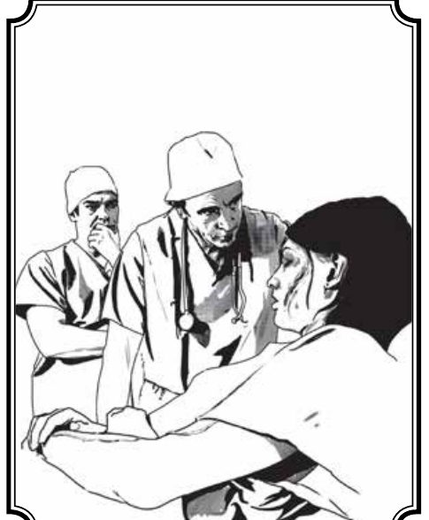

ребёнок может сочувствовать своим похитителям. Он постарается остаться с кем-то из сыщиков наедине и поговорить, чтобы распространить свою власть, — для этого нужна встречная проверка **МОЩ** (см. **«Силы Брэдли. 1. Распространить метку»**, с. 148).

Мари тщательно прибирает и уничтожает в доме всё, что может её выдать. Записи об обрядах-экспериментах и об издевательствах над Брэдли можно найти в дневниках, в пометках в оккультных книгах, на цифровых камерах и на компьютере (см. **«Записи Брэдли»**, с. 168). Здесь много часов записей, где голос говорит на гортанной латыни (это Брэдли). Часть записей Мари расшифровала и плохо перевела. Содержание — оккультного и религиозного характера. Объяснить это по-настоящему нечем, хотя Мари убеждена, что мальчиком овладел демон.

#### Вероятные действия после этой сцены

- Встреча с Брэдли может стать кульминацией, но, если ему это удобно, Брэдли может вести долгую игру. Кто-то из сыщиков может сбежать — чтобы собрать сведения, в том числе гаданием (см. **«Таро и спиритическая доска»**, с. 145), или чтобы избавиться от метки Брэдли (см. **«Ампутация»**, с. 166).

## Стейси в больнице

Стейси — пациентка палаты 2 психиатрического отделения местной больницы. Это не закрытое отделение, и хотя изначально Стейси госпитализировали принудительно (поместил сюда врач без её согласия), теперь она может уйти, если захочет. Однако Стейси уже настолько оправилась, что понимает: в больнице ей хорошо, и уходить она пока не собирается.

От кисти Стейси вверх по руке до самой груди тянется тонкий белый шрам. Врачи спрашивали её о нём, но Стейси отмалчивается, а шрам явно старый, и врачи не настаивали. Если Брэдли захочет, он может скрыть шрам от глаз сыщиков, потратив пункт магии и слегка исказив их восприятие.

Пребывание Стейси в больнице на руку Брэдли. Он мучил её разум, пока её не госпитализировали, и хочет, чтобы сыщики навестили её и услышали её печальную историю.

Стейси расскажет о ребёнке, которого родила от Дэвида Барбера. Если надавить, она признается, что при его зачатии они проводили магические обряды. Она опишет Брэдли как обычного мальчика и все трудности с ним объяснит собственными недостатками как матери. Судьбу Брэдли она помнит неверно и расскажет, что его взяли под опеку. Успешная проверка **Психологии** покажет, что Стейси что-то скрывает. Успешная проверка **Убеждения** или **Обаяния** заставит её раскрыться и признаться, что она сговорилась с Дэвидом оборвать жизнь своей старой матери в рамках магических обрядов, которые они провели вокруг зачатия Брэдли.

Если сыщикам удастся подружиться со Стейси, она скажет, что о её сыне заботится Мари. Если она это скажет, Брэдли высосет из неё пункты магии, а затем пункты здоровья, и через несколько раундов она потеряет сознание (см. **«Силы Брэдли. 2. Высасывание пунктов магии»**, с. 148). Если так случится, дайте игрокам ясно понять, что у них на глазах происходит что-то странное: они будто видят, как из неё вытягивают жизненную силу.

#### Вероятные действия после этой сцены

- Пойти домой к Саре или Дэвиду, если сыщики ещё этого не сделали (см. **«Дом Барберов»**, с. 160, или **«Дом Сары Мур»**, с. 159).
- Навестить Натана или Мари, если сыщики о них узнали (см. **«Дом Мари Кьюбин»**, с. 162, и **«Квартира Натана Хелда»**, с. 161).
- Сыщики могут собрать сведения о любом из персонажей (см. **«Сбор сведений»**, с. 164), в том числе гаданием (см. **«Таро и спиритическая доска»**, с. 145).
- Если сыщики решат не обращать внимания на историю Сары и ничего не делать, Брэдли каким-нибудь образом применит к ним свои силы (см. **«Силы Брэдли. 4. Галлюцинации»**, с. 149).
