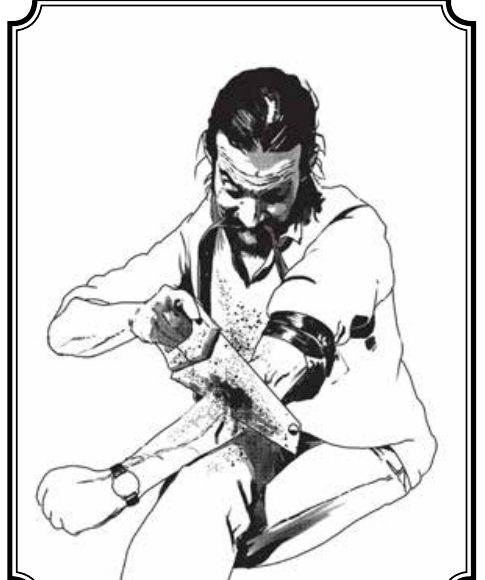

Если полиция всё же приедет в дом Мари, ей понадобятся достаточные улики или причина, чтобы войти. Войдя, полицейские не смогут воспринять Брэдли, но криминалистический обыск откроет следы по меньшей мере одного убийства, совершённого в последние недели (бездомного, принесённого в жертву Брэдли). Это приведёт к аресту Мари, Дэвида и Натана. Если в руки полиции попадёт компьютер Натана, он приведёт её в дом Мари с тем же исходом.

Если Мари, Дэвида и Натана арестуют, дом Мари оцепят как место преступления. Брэдли очень огорчится. Тогда он притянет к себе Стейси и Сару и заставит их отвезти его в другое место — может быть, в дом Сары, где он сможет играть с Шоном. Как им будет весело вместе! Со временем он продолжит свои планы — притянуть к себе сыщиков и окончательно утвердить свою власть над ними.

## Ампутация

Игрокам вполне может прийти в голову, что единственный способ по-настоящему освободиться от влияния Брэдли — ампутировать собственные конечности: кисть, предплечье или всю руку, в зависимости от того, куда дошёл шрам.

Если ампутацию делают без должной подготовки, она наносит 1d6 урона за кисть, 1d6+1 за предплечье и 1d6+2 за всю руку, а затем персонаж теряет 1 пункт здоровья каждую минуту из-за кровопотери. Остановить кровь поможет успешная проверка **ВЫН** самого пострадавшего или успешная проверка **Первой помощи** — его самого или другого человека. Каждую из этих проверок можно делать раз в минуту, пока персонаж не умрёт или пока кровь не остановят. Сколько бы пунктов здоровья ни было потеряно, персонаж получает серьёзную рану.

Если ампутацию делают с должной подготовкой (и успешной проверкой навыка **Медицины**), она наносит тот же урон и автоматически серьёзную рану, но кровотечение под контролем, и дальнейшего урона нет.

Если операцию проводили не в стерильных условиях (например, не в операционной), проверка лечения серьёзной раны делается со штрафной костью. Любой крах означает заражение или осложнение.

#### Как можно провести ампутацию

- Можно обратиться к медику, но ни один врач не согласится на такую операцию на здоровой конечности. Находчивый человек может найти способ уговорить врача провести ампутацию; тогда операцию можно сделать с минимальным риском заражения и кровопотери.
- Ампутацию может провести и человек без квалификации. Очень мало кто согласится на такое без веской причины. Кое-кто, может, и согласится — за хорошую цену или если его достаточно запугать. Но даже тогда он может не выдержать того, что приходится резать плоть и кость, и операция может пойти наперекосяк или оборваться на полпути.
- И наконец, персонаж может попытаться отрезать конечность сам. Известны случаи, когда люди делали так в крайних обстоятельствах, когда иначе их ждала верная смерть. Но даже в этом случае многие признаются, что всё равно не смогли бы такого сделать.

Сможет ли кто-то ампутировать кисть или руку — тут два варианта: либо персонаж достаточно безумен и отчаян, чтобы это сделать, либо он здраво убеждён, что это лучший выход. В первом случае персонаж должен пройти проверку Рассудка и провалить её (то есть чем ниже его Рассудок, тем вероятнее, что он провалит проверку и отрежет конечность). Если же он силой духа и воли заставляет себя совершить это, потребуйте успешной проверки **МОЩ** (медик, оперирующий пациента, может обойтись без этой проверки).

Проверять Рассудок или МОЩ — оставьте решать игроку. Если он провалит проверку, он может попытаться её повторить. Если повторная проверка провалена, постарайтесь придумать ужасное последствие: может быть, ему чудится, что шрам расползается по другим конечностям, и он рубит себя на куски; или в отчаянии и гневе он бросается с оружием на кого-то другого; или, если хочется чего-то чуть менее крайнего, он заливается слезами от того, что не в силах довести дело до конца (конечность ужасно изувечена, но не отнята).
