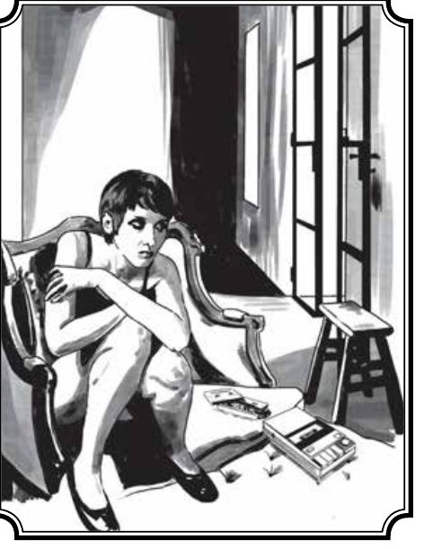

### Записи Брэдли

За эти годы Мари, Дэвид и Натан много раз беседовали с Брэдли и допрашивали его. Иногда разговоры шли мирно, иногда скатывались в ссоры, крик и брань. Мари, Дэвид и Натан говорят по-английски, а Брэдли — на разных языках: английском, латыни, акло, древнешумерском и нидерландском. Записи — вперемешку на магнитофонных кассетах и в цифровых файлах, всего сотни часов, и они плохо разобраны.

Видеть и слышать Брэдли могут только носители его метки. Те, кто не носит его метку, услышат только голоса допрашивающих (Мари, Дэвида и Натана). Если пару часов слушать подборку записей, этого хватит на начальное чтение книги; нужна успешная проверка **Слуха**. Прошедший проверку Слуха получает 2 пункта навыка Мифов Ктулху и теряет 1d6 Рассудка.

Тот, кого постигнет приступ безумия от чтения расшифровки «Записей Брэдли», рассечёт себе ладони и заключит договор со злой силой. С тех пор этот человек носит метку Брэдли (см. **«Метка Брэдли»**, с. 147) со всеми последствиями.

#### Записи Брэдли

- Изучение: 1 месяц. Потеря Рассудка: 1d6.
- Мифы Ктулху: +2% при начальном чтении, +4% при полном изучении.
- Значение Мифов: 18.
- Предлагаемые заклинания: «Покорение», «Повелевать животным».

## Приложение A. Персонажи

Ниже приведены характеристики каждого из главных персонажей Хранителя и чудовища (Брэдли), появляющихся в сценарии.

#### Дэвид Барбер, 41 год, человек на грани

```stat
СИЛ 65    ВЫН 50    ТЕЛ 70    ЛВК 55    ИНТ 65
НАР 55    МОЩ 80    ОБР 80    Рассудок 30   ПЗ 12
БкУ: +1d4   Комплекция: 1   Скорость: 6   ПМ: 16

Драка        25% (12/5), урон 1d3 + 1d4
Уклонение    36% (18/7)

Навыки: Средства 40%, Вождение автомобиля 35%, Запугивание 45%, Убеждение 60%.
```

#### Бриджит Барбер, 42 года, верная жена и мать

```stat
СИЛ 55    ВЫН 70    ТЕЛ 50    ЛВК 65    ИНТ 50
НАР 65    МОЩ 90    ОБР 70    Рассудок 50   ПЗ 12
БкУ: 0    Комплекция: 0   Скорость: 8   ПМ: 18

Драка        25% (12/5), урон 1d3
Уклонение    33% (16/6)

Навыки: Обаяние 30%, Механика 35%.
```

#### Сара Мур, 43 года, мать и наркоманка

```stat
СИЛ 50    ВЫН 50    ТЕЛ 60    ЛВК 70    ИНТ 55
НАР 45    МОЩ 80    ОБР 75    Рассудок 60   ПЗ 11
БкУ: 0    Комплекция: 0   Скорость: 7   ПМ: 16

Драка        25% (12/5), урон 1d3
Уклонение    35% (17/7)

Навыки: Средства 05%, Красноречие 60%, Ловкость рук 55%, Скрытность 40%.
```

#### Натан Хелд, 44 года, развращённый библиотекарь

```stat
СИЛ 85    ВЫН 40    ТЕЛ 80    ЛВК 35    ИНТ 85
НАР 45    МОЩ 60    ОБР 90    Рассудок 40   ПЗ 12
БкУ: +1d6   Комплекция: 2   Скорость: 7   ПМ: 12

Драка        40% (20/8), урон 1d3 + 1d6
Уклонение    20% (10/4)

Навыки: Убеждение 60%, Психология 55%, Ловкость рук 45%.
```

#### Стейси Кимбл, 42 года, женщина в беде

```stat
СИЛ 40    ВЫН 40    ТЕЛ 40    ЛВК 30    ИНТ 65
НАР 40    МОЩ 50    ОБР 75    Рассудок 40   ПЗ 8
БкУ: −1   Комплекция: −1   Скорость: 7   ПМ: 10

Драка        25% (12/5), урон 1d3 − 1
Уклонение    15% (7/3)
```
