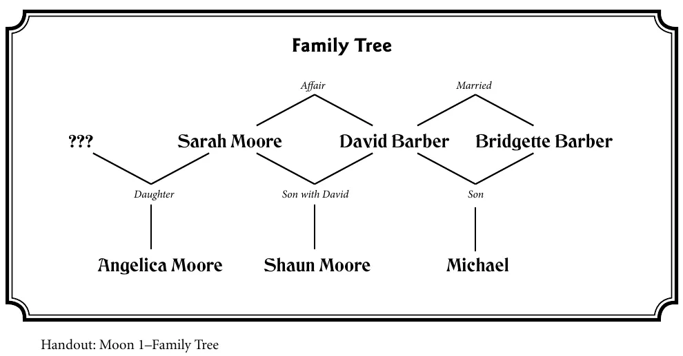

сведений приходит (о чём она не знает) от Брэдли; часть их правдива, в том числе тайные сведения о сыщиках, которых больше никто не должен знать.

- **В сети.** У Мелинды множество контактов в сети, и журналы её компьютера покажут, что она собирала сведения о других членах оккультного общества. Хранитель может смело добавить сюда подробности о других персонажах.
- **Где бывает.** Расследования Мелинды могут увести её куда угодно и когда угодно. В конце концов её притянет к Брэдли, и она поклянётся ему служить.

#### Что можно узнать о Рэе Уэсте — персонаже Хранителя

- **Круг общения.** Рэй знаком с разными библиофилами и владельцами книжных магазинов. Они подтвердят, что он хороший покупатель и живо интересуется оккультизмом.
- **Дом.** Дом Рэя полон самых разных книг; у него есть даже небольшая полка с неоккультными книгами. Книг Мифов Ктулху у него нет.
- **В сети.** Упорный поиск может откопать кое-что из его прозы (написанной под псевдонимом); она тревожная и исповедальная, а подробности оставлены воображению Хранителя. В части рассказов действуют едва прикрытые двойники сыщиков.
- **Где бывает.** Рэя можно застать на работе, в книжных магазинах или дома за чтением. В конце концов его притянет к Брэдли, и он поклянётся ему служить.

#### Что можно узнать о Мэгги Стерн — персонаже Хранителя

- **Круг общения.** Мэгги знают местные, которые увлекались оккультизмом до 2005 года. Они знали её как довольно отчаянную особу, готовую на что угодно ради острых ощущений.
- **Дом.** Мэгги живёт над своим магазином. Жилые комнаты вполне обыденные, а все оккультные книги и предметы запылились и давно не используются.
- **Работа.** В лавке «Энхиридион» есть записи о продаже Дэвиду и Натану разных книг и оккультных принадлежностей.
- **В сети.** Теперь Мэгги ведёт большую часть дел через интернет, и отзывы о ней в основном хорошие. Мэгги активна на форумах и в социальных сетях — в основном по делам магазина.
- **Где бывает.** Мэгги обычно можно застать дома или в магазине. В конце концов её притянет к Брэдли, и она поклянётся ему служить.

## Приложение B. Раздатки

> **Раздатка «Луна» 1: семейное древо**
>
> **Семейное древо**
>
> ??? — Сара Мур: дочь — Анджелика Мур
>
> Сара Мур — Дэвид Барбер: роман; сын от Дэвида — Шон Мур
>
> Дэвид Барбер — Бриджит Барбер: в браке; сын — Майкл
