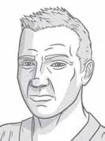

### Джон Винокур, 47 лет, медбрат



```stat
СИЛ 30    ВЫН 40    ТЕЛ 75    ЛВК 70    ИНТ 60
НАР 60    МОЩ 45    ОБР 85    Рассудок 45   ПЗ 11
БкУ: 0    Комплекция: 0   Скорость: 6   Удача: 50
ПМ: 9

Драка        25% (12/5), урон 1d3
Уклонение    35% (17/7)

Навыки: Средства 25%, Вождение автомобиля 40%, Первая помощь 80%, История 29%, Иностранный язык (французский) 31%, Иностранный язык (латынь) 21%, Слух 40%, Оккультизм 35%, Медицина 41%, Убеждение 60%, Психология 65%, Наука (биология) 31%, Наука (химия) 41%, Внимание 55%, Выживание (дикая природа) 30%.
```

#### Предыстория

- **Описание:** красив.
- **Идеология/убеждения:** твёрдая вера в карты Таро.
- **Значимые люди:** Джулс — любовь всей твоей жизни. Если бы только найти способ признаться в любви — неужели уже слишком поздно? Что тебя останавливает?
- **Значимое место:** любое место, где природа свободна и настоящая, — там покой и красота.
- **Ценная вещь:** перочинный нож, который ты носишь с собой с тех пор, как ребёнком играл в лесу.
- **Черта:** мечтатель. У тебя всегда безумные планы, которые никогда не срабатывают. Какой у тебя последний?

Ты работал в разных отделениях больницы, в том числе в приёмном покое. Теперь ты работаешь в психиатрическом отделении. Интерес к психическому здоровью у тебя пробудил опыт психологической помощи, которую ты сам получал с 2005 по 2007 год. Твой психолог очень помог тебе увидеть в себе хорошее и понять, как ты отравлял собственную жизнь наркотиками и самоповреждением. У тебя до сих пор множество шрамов — и душевных, и телесных.

Телесные шрамы легко скрыть длинными рукавами — кроме одного, на правой ладони. Ты получил его во время безумной пьяной студенческой гулянки в лесу. В ту ночь ты был так не в себе, что даже не помнишь, как добрался домой. Тогда ты водился с неформалами — компанией подражателей Оззи Осборна, помешанных на чёрной магии и Сатане!

Единственное, во что ты хоть немного верил, — карты Таро. У тебя есть колода, и в последнее время она срабатывает всё лучше. Ты можешь пользоваться ею в игре. Для этого нужен час, чтобы сосредоточиться и сделать полный расклад. Это стоит 4+1d6 пунктов магии, которые потом восстанавливаются по одному в час. Сделав расклад, ты можешь задать Хранителю один вопрос, на который можно ответить «да» или «нет».

Примерно полгода назад с тобой через социальные сети начали связываться старые друзья. Было бы неплохо снова сойтись с ними и повспоминать прошлое. История начнётся с того, что ты сидишь в кафе с несколькими из этих старых друзей и разговариваешь с Сарой Мур. Ты быстро поймёшь, что Сара Мур говорит о членах колледжского оккультного общества, в котором ты когда-то состоял. Вот остальные члены; некоторых из них играют другие игроки:

- Эрик Уилсон, *бухгалтер*.
- Алисия Хуико, *торговка антиквариатом, недавно овдовела*.
- Рэй Уэст, *работает в IT*.
- Мелинда Муди, *журналистка*.
- Мэгги Стерн, *управляет оккультным книжным магазином*.
- Сара Мур, *твоя история начинается со встречи с ней в кафе*.
- Дэвид Барбер, *работает в IT; женат на Бриджит*.
- Бриджит Барбер, *помощник учителя; замужем за Дэвидом*.
- Натан Хелд, *библиотекарь*.
- Мари Кьюбин, *управляющая банком*.
- Стейси Кимбл, *в больнице*.
- Грег Дрейпер, *гробовщик*.
