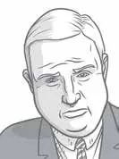

### Эрик Уилсон, 43 года, преуспевающий бухгалтер



```stat
СИЛ 40    ВЫН 45    ТЕЛ 70    ЛВК 50    ИНТ 80
НАР 20    МОЩ 65    ОБР 91    Рассудок 65   ПЗ 11
БкУ: 0    Комплекция: 0   Скорость: 6   Удача: 50
ПМ: 13

Драка        45% (22/9), урон 1d3
Уклонение    45% (22/9)

Навыки: Бухгалтерское дело 85%, Оценка 35%, Обаяние 35%, Работа с компьютером 35%, Средства 60%, Вождение автомобиля 40%, Электрика 20%, Красноречие 25%, Первая помощь 40%, История 29%, Юриспруденция 65%, Работа в библиотеке 30%, Оккультизм 45%, Убеждение 30%, Психология 40%, Ловкость рук 20%, Внимание 35%.
```

#### Предыстория

- **Описание:** полный, неуклюжий, выглядит нездоровым.
- **Идеология/убеждения:** ответы — у науки (вся эта история с тёмной материей перекликается с оккультизмом).
- **Значимые люди:** отец (ты пошёл по его стопам и взял на себя семейную фирму; ты должен заставить его гордиться тобой).
- **Значимое место:** Стоунхендж (место великой духовной силы, куда ты приезжаешь в каждое солнцестояние).
- **Ценная вещь:** отцовский перстень-печатка.
- **Черта:** великолепный повар — обожаешь смотреть кулинарные передачи по телевизору.
- **Травмы и шрамы:** у тебя нашли рак.

Работа позволяет тебе жить с удобствами, и жизнь обходилась с тобой вполне сносно, пока вчера ты не получил результаты от врача. Несколько месяцев назад у тебя начались проблемы с едой. Врачи диагностировали рак желудка. Тебе дали лекарства, и сейчас ты почти не чувствуешь недомогания. Лекарства должны уменьшить опухоль. Через пару месяцев тебя разрежут и посмотрят. Сейчас ты понимаешь, как коротка жизнь.

Много лет ты сидел на наркотиках, в основном на кокаине, но уже девять лет как чист. Когда оглядываешься на тогдашнюю жизнь, трудно поверить, что это был ты. От того, что ты творил в конце третьего и начале четвёртого десятка, тебя бросает в холод, и ты как можешь гонишь это из памяти. Насколько плохи были твои поступки с женщинами или с несговорчивыми наркоторговцами, решаешь ты, но где бы ни проходила твоя черта, знай: ты её переступил. Хранитель может спросить тебя об этом во время игры — приготовь ответ.

Шрамов у тебя хватает; на руке до сих пор шрам с той ночи в лесу. В колледже ты был тем ещё сорвиголовой и водился с оккультным обществом. Однажды ночью целая компания членов общества отправилась в лес и пела под звёздами. Теперь это лишь далёкое воспоминание, но, когда думаешь о нём, тебя мутит.

Единственный человек из колледжа, с которым ты не терял связи, — Алисия. Когда ей понадобились деньги на открытие антикварного дела, ты выручил её займом. Ты никогда ничего не просил взамен (кроме выплат с процентами, конечно). К сожалению, в начале этого года муж Алисии умер. С другой стороны, он тебе никогда не нравился. Может быть, теперь, когда его нет, Алисии понадобится плечо, на котором можно выплакаться.

Примерно полгода назад с тобой через социальные сети начали связываться старые друзья. Было бы неплохо снова сойтись с ними и повспоминать прошлое. История начнётся с того, что ты сидишь в кафе с несколькими из этих старых друзей и разговариваешь с Сарой Мур. Ты быстро поймёшь, что Сара Мур говорит о членах колледжского оккультного общества, в котором ты когда-то состоял. Вот остальные члены; некоторых из них играют другие игроки:

- Алисия Хуико, *торговка антиквариатом, недавно овдовела. В январе ты был на похоронах Гэри*.
- Рэй Уэст, *работает в IT*.
- Мелинда Муди, *журналистка*.
- Джон Винокур, *медбрат*.
- Мэгги Стерн, *управляет оккультным книжным магазином*.
- Сара Мур, *твоя история начинается со встречи с ней в кафе*.
- Дэвид Барбер, *работает в IT; женат на Бриджит*.
- Бриджит Барбер, *помощник учителя; замужем за Дэвидом*.
- Натан Хелд, *библиотекарь*.
- Мари Кьюбин, *управляющая банком*.
- Стейси Кимбл, *в больнице*.
- Грег Дрейпер, *гробовщик*.
