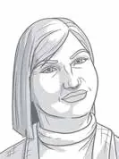

### Мелинда Муди, 42 года, журналистка



```stat
СИЛ 55    ВЫН 50    ТЕЛ 55    ЛВК 65    ИНТ 45
НАР 50    МОЩ 60    ОБР 73    Рассудок 60   ПЗ 10
БкУ: 0    Комплекция: 0   Скорость: 7   Удача: 70
ПМ: 12

Драка        25% (12/5), урон 1d3
Уклонение    32% (16/6)

Навыки: Искусство/ремесло (фотография) 55%, Лазание 50%, Средства 20%, Маскировка 65%, Красноречие 45%, История 25%, Работа в библиотеке 42%, Оккультизм 45%, Психология 30%, Ловкость рук 30%, Скрытность 60%.
```

#### Предыстория

- **Описание:** пухленькая и слегка неряшливая.
- **Идеология/убеждения:** ты обратилась в буддизм и проводишь время в медитации и молитве.
- **Значимые люди:** бабушка — она была замечательной женщиной, и ты берёшь с неё пример.
- **Значимое место:** бар, где общество собиралось в студенческие годы. Он преследует тебя во снах.
- **Ценная вещь:** записывающие принадлежности (блокнот, ручка, смартфон).
- **Черта:** гедонистка — обожаешь веселиться: жизнь коротка, так развлекайся!

Восемь лет ты работаешь в местной газете и пишешь обо всём, что происходит в округе, но всё это так провинциально. Тебе хотелось бы прорваться в большую журналистику и работать в общенациональной газете — или в интернет-изданиях, если там платят.

Твой духовный путь в жизни очень важен для тебя. Приняв буддизм, ты видишь всю ту языческую чепуху такой, какая она есть. Все эти кристаллы, амулеты, каменные круги — о чём ты только думала? Ты буддистка уже много лет — примерно с тех пор, как начала работать в местной газете, — и правда чувствуешь, что стала лучше. До того ты была полна страдания и передавала это страдание окружающим. Ты довела бывшего мужа Тайрона до безумия своим пьянством и изменами, и в конце концов он тебя бросил. Но теперь всё изменилось.

В начале 1990-х ты состояла в колледжском оккультном обществе. То были пьянящие студенческие дни. На руке у тебя до сих пор шрам с той ночи в лесу, когда целая компания членов общества пела и плясала вокруг рогатого черепа, с которого капала кровь. Теперь это лишь далёкое воспоминание, но, когда думаешь о нём, тебе становится тревожно.

Спиритические сеансы были твоей специальностью. Доставалась спиритическая доска, и ты общалась с духами. В колледже это отлично нагоняло драматизма. Но в последующие годы всё стало куда реальнее. Иногда ты и правда слышала голоса, которые шептали тебе, задавали вопросы или рассказывали то, чего ты никак не могла знать и что позже оказывалось правдой. Ты не слышала голосов много лет, но недавно, где-то за последний месяц, они вернулись. Если хочешь пообщаться с духами, опиши, как ты это делаешь (с помощью спиритической доски, впадая в транс и т. п.), и трать 1d10 пунктов магии за каждые несколько минут связи.

*Прим. перев.: в тексте для Хранителя (с. 145) 1d10 пунктов магии дают «несколько раундов (до одной минуты)» связи; так в оригинале.*

Примерно полгода назад с тобой через социальные сети начали связываться старые друзья. Было бы неплохо снова сойтись с ними и повспоминать прошлое. История начнётся с того, что ты сидишь в кафе с несколькими из этих старых друзей и разговариваешь с Сарой Мур. Ты быстро поймёшь, что Сара Мур говорит о членах колледжского оккультного общества, в котором ты когда-то состояла. Вот остальные члены; некоторых из них играют другие игроки:

- Эрик Уилсон, *бухгалтер*.
- Алисия Хуико, *торговка антиквариатом, недавно овдовела*.
- Рэй Уэст, *работает в IT*.
- Джон Винокур, *медбрат*.
- Мэгги Стерн, *управляет оккультным книжным магазином*.
- Сара Мур, *твоя история начинается со встречи с ней в кафе*.
- Дэвид Барбер, *работает в IT; женат на Бриджит*.
- Бриджит Барбер, *помощник учителя; замужем за Дэвидом*.
- Натан Хелд, *библиотекарь*.
- Мари Кьюбин, *управляющая банком*.
- Стейси Кимбл, *в больнице*.
- Грег Дрейпер, *гробовщик*.
