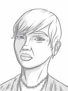

### Алисия Хуико, 44 года, торговка антиквариатом



```stat
СИЛ 55    ВЫН 60    ТЕЛ 60    ЛВК 55    ИНТ 60
НАР 25    МОЩ 55    ОБР 85    Рассудок 55   ПЗ 12
БкУ: 0    Комплекция: 0   Скорость: 6   Удача: 45
ПМ: 11

Драка        25% (12/5), урон 1d3
Уклонение    27% (13/5)

Навыки: Бухгалтерское дело 45%, Оценка 60%, Обаяние 55%, Средства 40%, Вождение автомобиля 50%, История 35%, Запугивание 45%, Оккультизм 30%, Внимание 55%, Плавание 50%.
```

#### Предыстория

- **Описание:** обычной внешности, разве что немного нескладная.
- **Идеология/убеждения:** убеждённая язычница; христианству за многое придётся ответить.
- **Значимые люди:** Эрик Уилсон — он такой умный, у него чудесная аура, а ещё он одолжил тебе денег на открытие дела.
- **Значимое место:** могила Гэри (твоего покойного мужа, который тоже состоял в обществе).
- **Ценная вещь:** ювелирная лупа, которую Гэри подарил тебе на последнюю годовщину свадьбы.
- **Черта:** славишься тем, что бесстрашно говоришь всё, что думаешь.

*Прим. перев.: на с. 158 сказано, что Гэри не был одним из Тринадцати; он мог быть рядовым членом общества, не из комитета.*

Год выдался для тебя тяжёлым. В январе ты потеряла мужа, Гэри. Он был заядлым мотоциклистом и твердил, что раз весна почти на пороге, пора выкатить мотоцикл из сарая и смахнуть с него паутину. Что именно стало причиной аварии на тех загородных дорогах, так и не выяснилось; может быть, гололёд.

Ты была замужем за Гэри с 2005 года, после недолгого романа. Гэри очень изменил твою жизнь. До Гэри ты вечно тревожилась и не находила себе места; порой ты боялась за свой рассудок. Тебе казалось, что ты слышишь голоса — мерзкие голоса, которые хотели, чтобы ты кое-что сделала. Но ты им сопротивлялась. Ведь ты сопротивлялась им, правда?

Эрик Уилсон был тебе хорошим другом. Несколько лет назад ты снова с ним связалась, и он одолжил тебе денег на открытие антикварного дела. Гэри, твой покойный муж, всегда ревновал тебя к Эрику; было ли между вами что-то большее, чем дружба, решаешь ты.

С Эриком ты познакомилась в колледже. Вы оба состояли в колледжском оккультном обществе. То были пьянящие студенческие дни, в начале 1990-х. На руке у тебя до сих пор шрам с той ночи в лесу. Однажды ночью целая компания членов общества отправилась в лес и пела под звёздами. Теперь это лишь далёкое воспоминание, но, когда думаешь о нём, тебе становится тревожно.

Примерно полгода назад с тобой через социальные сети начали связываться старые друзья. Было бы неплохо снова сойтись с ними и повспоминать прошлое. История начнётся с того, что ты сидишь в кафе с несколькими из этих старых друзей и разговариваешь с Сарой Мур. Ты быстро поймёшь, что Сара Мур говорит о членах колледжского оккультного общества, в котором ты когда-то состояла. Вот остальные члены; некоторых из них играют другие игроки:

- Эрик Уилсон, *бухгалтер и друг. В январе он был на похоронах Гэри*.
- Рэй Уэст, *работает в IT*.
- Мелинда Муди, *журналистка*.
- Джон Винокур, *медбрат*.
- Мэгги Стерн, *управляет оккультным книжным магазином*.
- Сара Мур, *твоя история начинается со встречи с ней в кафе*.
- Дэвид Барбер, *работает в IT; женат на Бриджит*.
- Бриджит Барбер, *помощник учителя; замужем за Дэвидом*.
- Натан Хелд, *библиотекарь*.
- Мари Кьюбин, *управляющая банком*.
- Стейси Кимбл, *в больнице*.
- Грег Дрейпер, *гробовщик*.
