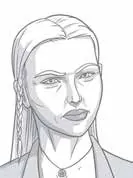

### Мэгги Стерн, 41 год, управляющая магазином



```stat
СИЛ 50    ВЫН 65    ТЕЛ 45    ЛВК 60    ИНТ 70
НАР 70    МОЩ 60    ОБР 74    Рассудок 55   ПЗ 11
БкУ: 0    Комплекция: 0   Скорость: 8   Удача: 45
ПМ: 11

Драка        25% (12/5), урон 1d3
Уклонение    30% (15/6)

Навыки: Бухгалтерское дело 45%, Оценка 45%, Работа с компьютером 25%, Средства 50%, Вождение автомобиля 30%, Красноречие 35%, Иностранный язык (нидерландский) 40%, Работа в библиотеке 30%, Механика 39%, Оккультизм 65%, Убеждение 35%, Психология 40%, Ловкость рук 25%, Внимание 40%, Скрытность 45%.
```

*Прим. перев.: у Уклонения в оригинале напечатано «30% (15/)» — пятая доля (6) дописана. ПМ 11 при МОЩ 60 (по правилам было бы 12) — как в оригинале.*

#### Предыстория

- **Описание:** природная красавица, косметикой не пользуешься.
- **Идеология/убеждения:** реальность не такова, какой мы её считаем. Нас окружают духи.
- **Значимые люди:** Боб Марли вдохновляет тебя, и ты постоянно слушаешь его музыку.
- **Значимое место:** «Энхиридион» — твой дом и место работы.
- **Ценная вещь:** семейная Библия.
- **Черта:** у тебя что на уме, то и на языке — все чувства напоказ.

Когда хочешь произвести впечатление, ты говоришь людям, что ты управляющая магазином. В былые времена ты бы сказала всё как есть: ты лавочница и гордишься этим. Твой магазин «Энхиридион» — маленькая лавка, где продаются всевозможные книги и принадлежности, связанные с магией и оккультизмом. Ты взяла его пятнадцать лет назад, бывали взлёты и падения, но тебе удалось пережить рецессию и собрать преданную клиентуру. В последние годы дело стало разнообразнее, и теперь значительная его часть — продажи через интернет, но коллекционерам книг всегда хочется потрогать и понюхать кожаные переплёты.

*Прим. перев.: здесь название лавки напечатано «Enchirodion», выше — «Enchiridion»; в переводе — «Энхиридион».*

Когда ты начинала, ты была полна энтузиазма ко всему магическому и оккультному, но с годами он угас, а на его место пришёл интерес к делу и вложениям. Твоя мать умерла в 2004 году, и на наследство ты купила магазин; с тех пор твоё отношение к жизни и к делу изменилось — ты чувствуешь больше ответственности. Может быть, ты наконец повзрослела, и вот каково это — быть взрослой.

В начале 1990-х ты состояла в колледжском оккультном обществе. То были пьянящие студенческие дни. На руке у тебя до сих пор шрам с той ночи в лесу, когда компания членов общества пела и плясала, совершая обряд в честь Рогатого бога. Теперь это лишь далёкое воспоминание, но, когда думаешь о нём, тебе становится тревожно.

В годы после колледжа ты участвовала во множестве обрядов, спиритических сеансов и магических ритуалов. Ты водилась с людьми сомнительного сорта, которые, как ты теперь понимаешь, просто пользовались окружающими, чтобы утолить свои извращённые желания, а вовсе не ради каких-то высших духовных целей. Что именно творилось на худших из тех собраний и насколько мрачно и порочно всё стало, решаешь ты как игрок.

Примерно полгода назад с тобой через социальные сети начали связываться старые друзья. Было бы неплохо снова сойтись с ними и повспоминать прошлое. История начнётся с того, что ты сидишь в кафе с несколькими из этих старых друзей и разговариваешь с Сарой Мур. Ты быстро поймёшь, что Сара Мур говорит о членах колледжского оккультного общества, в котором ты когда-то состояла. Вот остальные члены; некоторых из них играют другие игроки:

- Эрик Уилсон, *бухгалтер*.
- Алисия Хуико, *торговка антиквариатом, недавно овдовела*.
- Рэй Уэст, *работает в IT*.
- Джон Винокур, *медбрат*.
- Мелинда Муди, *журналистка*.
- Сара Мур, *твоя история начинается со встречи с ней в кафе*.
- Дэвид Барбер, *работает в IT; женат на Бриджит*.
- Бриджит Барбер, *помощник учителя; замужем за Дэвидом*.
- Натан Хелд, *библиотекарь*.
- Мари Кьюбин, *управляющая банком*.
- Стейси Кимбл, *в больнице*.
- Грег Дрейпер, *гробовщик*.
