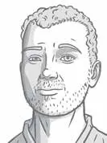

### Рэй Уэст, 45 лет, IT-специалист



```stat
СИЛ 45    ВЫН 50    ТЕЛ 70    ЛВК 60    ИНТ 45
НАР 50    МОЩ 60    ОБР 62    Рассудок 60   ПЗ 12
БкУ: 0    Комплекция: 0   Скорость: 6   Удача: 55
ПМ: 12

Драка        25% (12/5), урон 1d3
Уклонение    30% (15/6)

Навыки: Работа с компьютером 75%, Средства 38%, Электрика 40%, Электроника 21%, Иностранный язык (латынь) 21%, Юриспруденция 15%, Работа в библиотеке 30%, Взлом 31%, Оккультизм 35%, Психология 30%, Наука (математика) 31%, Внимание 45%.
```

#### Предыстория

- **Описание:** моложавая внешность.
- **Идеология/убеждения:** деньги — это власть. Хотя, похоже, их у тебя никогда не будет достаточно.
- **Значимые люди:** сестра (Кэт): вас вместе отдали в приёмную семью. Во всём мире у вас есть только вы друг у друга.
- **Значимое место:** паб, где общество собиралось, когда ты учился в колледже, — столько счастливых воспоминаний.
- **Ценная вещь:** твоя собака. Какой она породы? Как её зовут?
- **Черта:** обожаешь собак и всюду берёшь своего питомца с собой.

Днём ты работаешь в IT. Работа оплачивает жильё и книги. Ты вечно прочёсываешь книжные магазины в поисках малоизвестных книг о магии — особенно тех, что больше не издаются: редких томов, которые откроют путь к большей силе и знанию. Ты искал такие сведения в сети, но их там просто нет. Они хранятся в тщательно оберегаемых бумагах, а не в электронике.

Твой интерес к оккультизму расцвёл в начале 1990-х, когда ты учился в колледже. Ты дружил с парнем по имени Дэвид Барбер, и вдвоём вы основали колледжское оккультное общество. Ты не видел Дэвида с тех пор, как у него на последнем курсе случился нервный срыв. Дэвид относился ко всей этой магии очень серьёзно — пожалуй, до одержимости. Однажды ночью ты отправился в лес с целой компанией членов общества, и вы провели обряд поклонения Богине-матери. Давались кровавые клятвы; всё это было довольно нелепо и наивно. Не считая шрама на правой ладони, теперь это лишь далёкое воспоминание, но, когда думаешь о нём, тебе становится тревожно.

Уже восемь лет ты занимаешься йогой и правда чувствуешь пользу. До того в твоём теле копилось много напряжения; говорят, твои чакры застоялись. Наверное, этим и объясняется вся та тоскливая писанина, которой ты занимался, когда тебя мучила бессонница. Твои романы до сих пор лежат на жёстком диске — там они, скорее всего, и останутся.

Примерно полгода назад с тобой через социальные сети начали связываться старые друзья. Было бы неплохо снова сойтись с ними и повспоминать прошлое. История начнётся с того, что ты сидишь в кафе с несколькими из этих старых друзей и разговариваешь с Сарой Мур. Ты быстро поймёшь, что Сара Мур говорит о членах колледжского оккультного общества, в котором ты когда-то состоял. Вот остальные члены; некоторых из них играют другие игроки:

- Эрик Уилсон, *бухгалтер*.
- Алисия Хуико, *торговка антиквариатом, недавно овдовела*.
- Мелинда Муди, *журналистка*.
- Джон Винокур, *медбрат*.
- Мэгги Стерн, *управляет оккультным книжным магазином*.
- Сара Мур, *твоя история начинается со встречи с ней в кафе*.
- Дэвид Барбер, *работает в IT; женат на Бриджит*.
- Бриджит Барбер, *помощник учителя; замужем за Дэвидом*.
- Натан Хелд, *библиотекарь*.
- Мари Кьюбин, *управляющая банком*.
- Стейси Кимбл, *в больнице*.
- Грег Дрейпер, *гробовщик*.
