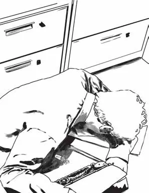

*Чандлер за работой*

Чандлер удалился от мира, чтобы медитировать и писать. Ходили слухи, что он сошёл с ума или пристрастился к наркотикам. Церковь эти обвинения отрицала, но доля правды была и в том, и в другом. Изучая религиозные и оккультные сочинения, Чандлер наткнулся на ряд упоминаний Мифов, которые в конце концов привели его к экземпляру «Сассекской рукописи». Книга отравила его разум и повела его медитации по новым, нездоровым путям. Труды Чандлера наполнились упоминаниями Голодной Пустоты и чуждых разумов, обитающих в пространствах между звёздами. Он уверился, что путь к истинной «Пустоте» лежит в том, чтобы пригласить эти разумы пожрать все наши человеческие слабости.

Пока Чандлер погружался в безумие и злоупотреблял стимуляторами, Церковь процветала. В 1978 году восторженный молодой последователь Чандлера, Брайан Масгроув, взял на себя повседневное управление Церковью, освободив наставника для написания священных текстов. Масгроув был прагматичнее Чандлера, и Церковь быстро росла. Понимая, что поздние писания Чандлера напугают непосвящённых, Масгроув ввёл новую структуру, ограничивающую доступ к более эзотерическим сторонам учения. Священные книги выдавались членам Церкви в зависимости от их уровня понимания, а продвижение зависело от того, сочтут ли вышестоящие их готовыми принять новые учения. Лишь очень немногих сочли достаточно сильными, чтобы вынести учения высшего уровня, и большинство даже не подозревало, что такие учения существуют.

Церковь при новом порядке упрекали в том, что она наживается на своих членах. Курсы и консультации стоили немалых денег, и многие, застрявшие на месте прежде, чем дошли до внутренних учений, чувствовали, что за большие деньги получили мало ценного. Несмотря на обвинения, для Церкви это было время бурного роста, и число её членов увеличивалось по всему миру.

Другая беда Церкви была в том, что она никак не могла избавиться от ярлыка «секты». Разные правительства заинтересовались налоговыми делами Церкви, бывшие члены писали разоблачения, и Масгроув решил, что больше всего Церкви нужна респектабельность.

### Ставка на знаменитостей

Масгроув решил, что лучший способ добиться для Церкви хорошей прессы — поддержка знаменитостей, и в 1985 году начал кампанию по вербовке людей из индустрии развлечений. Церковь могла предложить им две вещи: приёмы самосовершенствования, позволяющие полностью раскрыть свой потенциал, и сеть знакомств в индустрии, способную поддержать их карьеру.

Чтобы удержать новичков в Церкви, Масгроув решил обучать их лишь небольшой части церковных писаний. Церковь открыла роскошный Ретрит знаменитостей в особняке на Голливудских холмах, где проходили особые курсы и консультации. Лишь горстку завербованных знаменитостей сочли достойными внутренних учений. Одним из них был актёр Крейг Стил, за долгую карьеру снявшийся во многих блокбастерах. В глазах многих он стал публичным лицом Церкви Шуньяты.

### Истинная Пустота

Ральф Л. Чандлер умер в 1995 году. Официальной причиной смерти назвали болезнь сердца; связь с его пристрастием к амфетаминам замяли. Многое из его трудов было собрано и отредактировано в церковные писания, но после него осталось множество заметок, которые сочли слишком бессвязными для использования.

Стил годами разбирал эти заметки. Он достиг вершины церковной иерархии, много раз беседовал с Чандлером наедине о его учении и получил в наследство личную библиотеку Чандлера, в том числе «Сассекскую рукопись» и обширный разбор её, сделанный Чандлером. Всё это позволило Стилу совершить концептуальный прорыв и первым понять, что на самом деле значит быть «Пустым».

Озарение пришло к Стилу в камере сенсорной депривации, когда он медитировал над последними сочинениями Чандлера. В одно мгновение, длившееся вечность, он ощутил пустое пространство между всеми вещами как конкретную истину. Всё, из чего состоял Крейг Стил, мгновенно исчезло. Существо, вышедшее из камеры, носило кожу Стила, но внутри него была Голодная Пустота.
