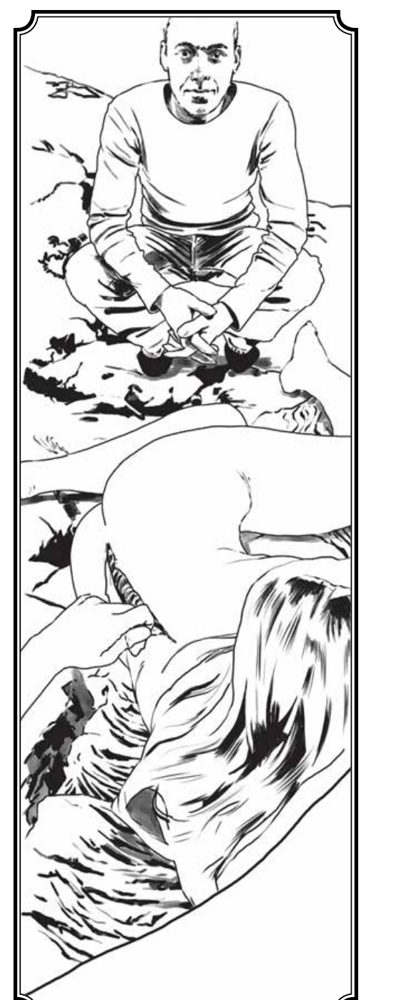

Это случилось почти два года назад, и до сих пор единственный, кого Стил сделал Истинно Пустым, — Брайан Масгроув. Мало у кого из членов Церкви хватает глубины понимания. Это препятствие заставило Стила искать другие пути.

Первый подход сочетал ритуал и хирургию. Если с человека живьём снять кожу, а затем воззвать к Открывателю Пути, чтобы тот наполнил эту оболочку Голодной Пустотой, кожу оживит отголосок того, кем человек был. Это оказалось не так удачно, как надеялся Стил: у «Опустошённых», как он их называет, всё ещё остаются некоторые человеческие заботы и сомнения. Второе решение — напрямую открыть человеческий разум истине Пустоты через зрительный образ. Стил верит, что, если вмонтировать в фильм подсознательные образы, связанные с Мифами, Голодная Пустота коснётся разума зрителя и заменит все его горести дивной Пустотой. Чтобы воплотить свой замысел, он призвал Джареда Вудворда — успешного кинорежиссёра и высокопоставленного члена Церкви. Вудворд уже шесть недель снимает этот фильм — «Пространство между»; именно в этом производстве и участвуют все сыщики.

### Смерть Верити Харроу

План Стила и Вудворда состоял в том, чтобы снять на плёнку ритуальное и хирургическое превращение Верити Харроу в одну из Пустых, а затем вмонтировать отдельные кадры — подсознательно — в ту сцену фильма, где впервые появляется Иветт Соммерс. Так, верили они, получится проводник, через который Пустота сможет коснуться зрителей. Как только Вудворд и Харроу сняли сцены, где Кларисса (Харроу) во сне встречает Иветт на базальтовых утёсах, руки у них были развязаны для ритуала.

Харроу участвовала добровольно. Как истовая прихожанка, она отчаянно хотела стать Истинно Пустой — даже после того, как Вудворд рассказал ей, что для этого потребуется. В ночь на 3 апреля она встретилась с Вудвордом и Стилом в павильоне, и они её Опустошили.

*Прим. перев.: в оригинале — «встретилась с Харроу и Стилом»; по смыслу — с Вудвордом и Стилом.*

Втроём они начертили кровью Харроу круг и разные сигилы на декорации базальтовых утёсов. Пока Стил читал из экзегезы Чандлера, Вудворд ритуальным ножом из личной коллекции Стила живьём снял с Харроу кожу. Это была мучительная процедура: Харроу умирала почти полчаса. Камера сняла каждую секунду.

Получив кожу Харроу, Вудворд хирургическими нитками сшил её обратно в человеческую форму, а Стил тем временем призывал Открывателя Пути. Наконец Голодная Пустота вошла в кожу Харроу, и та очнулась — Пустой.

Стил отвёз Опустошённую Харроу в Ретрит знаменитостей, а Вудворд отбелил декорацию и избавился от остатков в ближайшем ливнёвом стоке.

С тех пор Харроу никто не видел. Стил держит её подальше от публики: она ещё привыкает к своему новому состоянию, и её поступки непредсказуемы. Трудно

