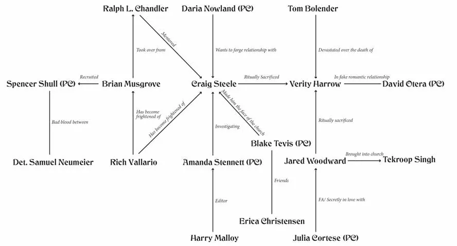

## Карта связей

Подписи карты (ГС — готовый сыщик):

| Кто | Связь |
|---|---|
| Ральф Л. Чандлер → Крейг Стил | наставлял |
| Брайан Масгроув → Ральф Л. Чандлер | принял дела у него |
| Брайан Масгроув → Спенсер Шалл (ГС) | завербовал |
| Дария Ноуленд (ГС) → Крейг Стил | хочет сблизиться |
| Том Болендер → Верити Харроу | убит горем из-за её гибели |
| Крейг Стил → Верити Харроу | ритуально принёс в жертву |
| Верити Харроу — Дэвид Отера (ГС) | фиктивный роман |
| Спенсер Шалл (ГС) — детектив Сэмюэл Ноймайер | давняя вражда |
| Рич Валларио → Брайан Масгроув | стал его бояться |
| Рич Валларио → Крейг Стил | стал его бояться |
| Аманда Стеннетт (ГС) → Крейг Стил | расследует |
| Блейк Тевис (ГС) → Крейг Стил | сделал его лицом Церкви |
| Джаред Вудворд → Верити Харроу | ритуально принёс в жертву |
| Джаред Вудворд → Текруп Сингх | привёл в Церковь |
| Блейк Тевис (ГС) — Эрика Кристенсен | друзья |
| Гарри Маллой → Аманда Стеннетт (ГС) | редактор |
| Джулия Кортезе (ГС) → Джаред Вудворд | личная помощница; тайно влюблена |
