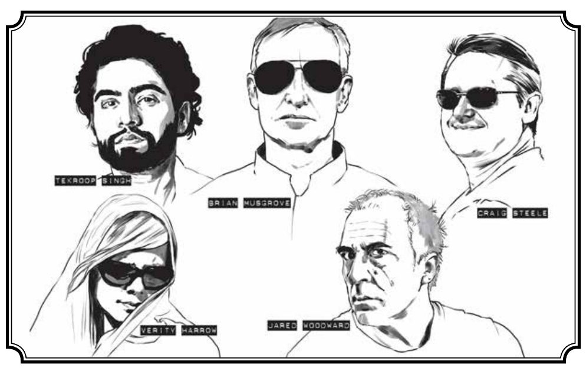

*Действующие лица (на табличках: Текруп Сингх, Брайан Масгроув, Крейг Стил, Верити Харроу, Джаред Вудворд)*

Существо, носящее кожу Стила, хладнокровно, нечеловечно и совершенно обаятельно. Оно довело до совершенства искусство выдавать себя за Стила, и даже ближайшие помощники считают, что после ухода на покой он просто стал чудаковатее.

Увидеть Истинно Пустого таким, какой он есть, — через глаза, рот или проколотую кожу — проверка Рассудка (1/1d8).

Подробнее — в описании Истинно Пустых (с. 186 и 206).

**Описание:** когда-то мальчишески красивый мужчина, теперь располневший, с обвисшими щеками. Волосы у Стила сильно поредели; он больше не тщеславен, но носит накладку, потому что этого от него ждут. В присутствии людей носит тёмные солнечные очки с широкими дужками.

**Черты:** благодаря обширным досье на членов Церкви Стил часто знает о людях чрезвычайно личные подробности и вставляет их в разговор, чтобы напомнить, кто здесь главный.

**Зацепки для отыгрыша:**

- Задаёт сыщикам вопросы, чтобы понять, опасны ли они.
- Не смотрит в глаза — говоря, пусто глядит мимо игроков.

### Брайан Масгроув, Истинно Пустой глава Церкви Шуньяты

В начале игры Масгроув — единственный, кроме Стила, кто истинно Опустошён. Как и Стил, он — воплощение Голодной Пустоты, завёрнутое в человеческую кожу. Несмотря на это, он сохранил положение главы Церкви Шуньяты и правит из уединения своего кабинета.

Масгроув не так ловко изображает человека, как Стил. Его голос странно отдаётся эхом, а при людях он, разговаривая, прикрывает рот рукой, чтобы скрыть то, что внутри.

Подробнее — в описании Истинно Пустых (с. 186 и 206).

**Описание:** Масгроув — высокий подтянутый белый мужчина лет пятидесяти пяти с короткими седеющими волосами. Он носит белую рубашку без воротника в едва заметную вертикальную полоску и простой чёрный костюм. Обувь надевает лишь в тех редких случаях, когда выходит из кабинета. Глаза его всегда скрыты солнечными очками в чёрной оправе, которые выглядят слишком большими для его узкого лица.

**Черты:** как и при жизни человеком, Масгроув тих, но напорист: задаёт прямые, пронизывающие вопросы с резкостью, граничащей с грубостью. Он никогда не повышает голоса, но держится властно и устрашающе.

**Зацепки для отыгрыша:**

- Запугивает и унижает тех, кто тратит его время впустую.
- Не смотрит в глаза — пусто глядит мимо игроков и, говоря, прикрывает рот.
