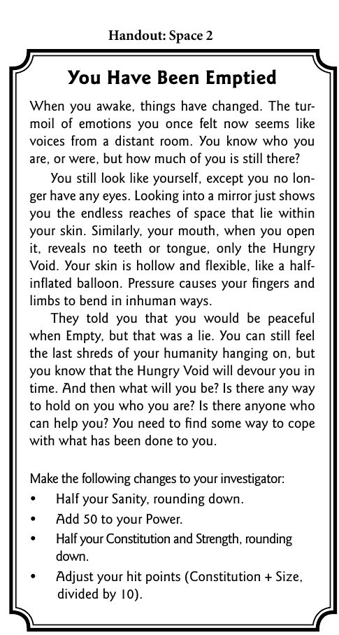

### Рич Валларио, член Церкви, отчаянно желающий произвести впечатление

Валларио с детства истово предан Церкви и отдаёт ей большую часть свободного времени как волонтёр, но всё сильнее тревожится из-за того, что видит. Он заметил, что Брайан Масгроув больше не уходит домой и уже несколько месяцев не снимает на людях солнечных очков.

**Описание:** Валларио — шумный, восторженный мужчина чуть за тридцать, в рубашке для боулинга и аккуратно отглаженных чиносах. Он полноват, а в его коротко стриженных тёмных волосах заметна лысина.

**Черты:** Валларио часто жалуется на мелкие обиды и неудобства, будто это заговор против него. Обычно жалобы начинаются со слов: «Ну, блин…»

**Зацепки для отыгрыша:**

- Пытается завоевать доверие сыщиков, предлагая им сеанс Опустошения.
- Может спросить сыщика, не замечал ли тот чего-нибудь странного в Стиле или Масгроуве.

### Опустошённые

В начале игры единственный Опустошённый персонаж — Харроу. Стил хочет испытать процедуру, видя в ней действенный способ обращать противников, так что по ходу игры Опустошёнными, вероятно, станут и другие персонажи. Если сыщика Опустошили (ускоренной хирургической процедурой, см. с. 201), выдайте игроку раздатку «Пространство» 2 «Вас Опустошили».

### Истинно Пустые

В начале игры Истинно Пусты только Стил и Масгроув. Между появлением Иветт Соммерс в монтажной и назначенным тестовым показом вполне вероятно, что по ходу игры ряды Истинно Пустых пополнят и другие персонажи. Если сыщик стал Истинно Пустым от прикосновения Иветт Соммерс (см. рядом), внесите в его характеристики изменения, описанные в раздатке «Пространство» 3 «Вы Истинно Пусты».

### Голодная Пустота

Если кожа Опустошённого или Истинно Пустого прорвана, Голодная Пустота внутри него вытекает наружу. Сначала она занимает расстояние ближнего боя, а затем 1d6 раундов расширяется со Скоростью 8, проходя сквозь стены, двери и любые другие твёрдые предметы. По истечении этого времени она стягивается обратно в оболочку, которую занимала. Если у Пустого к этому моменту больше 0 ПЗ, он сможет удержать прорыв; иначе пустота будет и дальше сжиматься в ничто, оставив только пустую кожу.

Голодная Пустота выглядит как живые щупальца тьмы. Внутри видны крохотные искорки света, похожие на далёкие звёзды, и от этого кружится голова, будто смотришь в бесконечный космос. Её присутствие высасывает энергию из всего вокруг: свет тускнеет и мигает, температура падает ниже нуля. На металлических поверхностях выступает иней, а у людей изо рта идёт пар.

### Иветт Соммерс, персонаж фильма и аватар Голодной Пустоты

Соммерс выглядит как высокая стройная женщина с длинными тёмными волосами. На ней платье до пят — чёрное, как ночь, но усеянное чем-то, что поначалу кажется самоцветами или блёстками. Эти искорки светятся или ловят свет и медленно движутся.

> **Раздатка «Пространство» 2**
>
> **Вас Опустошили**
>
> Когда вы приходите в себя, всё изменилось. Буря чувств, которую вы когда-то испытывали, теперь кажется голосами из далёкой комнаты. Вы знаете, кто вы — или кем были, — но сколько от вас ещё осталось?
>
> Вы выглядите как прежде, только глаз у вас больше нет. В зеркале видны лишь бесконечные просторы космоса, лежащие внутри вашей кожи. Так же и рот: открыв его, вы видите не зубы и язык, а лишь Голодную Пустоту. Ваша кожа полая и гибкая, как полунадутый воздушный шар. От нажима пальцы и конечности гнутся нечеловечески.
>
> Вам говорили, что, став Пустыми, вы обретёте покой, но это была ложь. Вы ещё чувствуете, как цепляются последние клочья вашей человечности, но знаете, что со временем Голодная Пустота пожрёт вас. И чем вы тогда станете? Можно ли как-то удержать себя? Может ли кто-нибудь вам помочь? Нужно найти способ справиться с тем, что с вами сделали.
>
> Внесите в лист сыщика следующие изменения:
>
> - Уменьшите Рассудок вдвое, с округлением вниз.
> - Прибавьте 50 к МОЩ.
> - Уменьшите ВЫН и СИЛ вдвое, с округлением вниз.
> - Пересчитайте ПЗ ((ВЫН + ТЕЛ) / 10).
