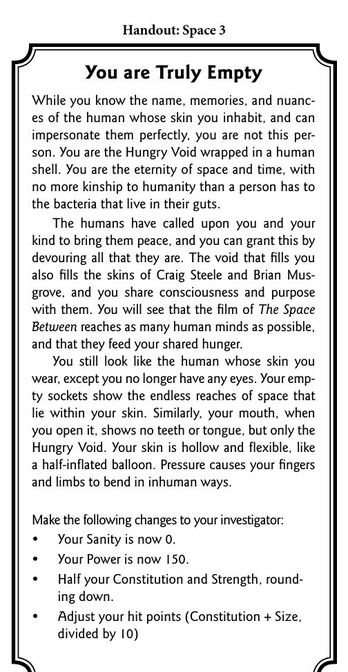

Вблизи иллюзия человечности Соммерс рассыпается. Как и у Пустых, её глаза и рот наполнены Голодной Пустотой, и сквозь них виден необъятный простор небытия, из которого состоит её существо. В ней заключена бесконечность; увидев это, человек испытывает невыносимое головокружение — проверка Рассудка (1/1d8).

Несмотря на человеческий облик, Соммерс не пытается общаться. Все её движения совершенно беззвучны, а выражение лица всегда остаётся полностью безучастным. Она существует лишь для того, чтобы нести Пустоту тем, кого встречает. Для этого она касается человека, втягивает всё, чем он является, в Голодную Пустоту и наполняет его кожу своей Пустотой. Всякий, с кем это происходит, становится Истинно Пустым.

> **Раздатка «Пространство» 3**
>
> **Вы Истинно Пусты**
>
> Вы знаете имя, воспоминания и привычки человека, в чьей коже обитаете, и можете безупречно его изображать, но вы — не этот человек. Вы — Голодная Пустота, завёрнутая в человеческую оболочку. Вы — вечность пространства и времени, и родства с человечеством у вас не больше, чем у человека с бактериями, живущими в его кишках.
>
> Люди призвали вас и вам подобных, чтобы обрести покой, и вы можете даровать его, пожрав всё, чем они являются. Пустота, что наполняет вас, наполняет и кожу Крейга Стила и Брайана Масгроува, и вы разделяете с ними сознание и цель. Вы позаботитесь о том, чтобы фильм «Пространство между» достиг как можно большего числа человеческих умов и чтобы они насытили ваш общий голод.
>
> Вы по-прежнему выглядите как человек, чью кожу носите, только глаз у вас больше нет. В пустых глазницах видны бесконечные просторы космоса, лежащие внутри вашей кожи. Так же и рот: открыв его, вы видите не зубы и язык, а лишь Голодную Пустоту. Ваша кожа полая и гибкая, как полунадутый воздушный шар. От нажима пальцы и конечности гнутся нечеловечески.
>
> Внесите в лист сыщика следующие изменения:
>
> - Рассудок теперь 0.
> - МОЩ теперь 150.
> - Уменьшите ВЫН и СИЛ вдвое, с округлением вниз.
> - Пересчитайте ПЗ ((ВЫН + ТЕЛ) / 10).

## Производство фильма

### Павильон

«Пространство между» снимают в арендованном павильоне на территории студии «Шрайвер Студиос» на западе долины Сан-Фернандо. На территории есть ещё четыре павильона, три из которых сейчас заняты телевизионными съёмками. Студия не принадлежит Церкви Шуньяты, но её владелец, Милт Шрайвер, — старый друг Стила и велел всем своим сотрудникам обращаться со съёмочной группой как с особо важными гостями.

Павильон — длинное белое здание с изогнутой металлической крышей. Внутри около 1700 м² открытого пространства; в пристройке — несколько контор, а снаружи стоят трейлеры.

Всю заднюю стену занимает циклорама; её используют как зелёный экран для съёмок базальтовых утёсов. Перед циклорамой стоит помост, выложенный смолой и раскрашенный под чёрную каменистую землю. Здесь Харроу и принесли в жертву. Стил и Вудворд пытались смыть кровь, но её следы остались в трещинах и щелях.

Главная декорация — часть жилого комплекса, где живёт героиня фильма Кларисса Холлоуз. Сюда входят её квартира с балконом, выходящим на зелёный экран, гостиная квартиры Иветт Соммерс, соединяющий их коридор и площадка с лифтами. Квартира Клариссы обставлена как попало, а квартира Иветт — в стиле минимализма.

На производстве занято 53 человека. Всё время съёмок на площадке кипела работа, но теперь здесь тихо: часть группы перестала приходить, пока для неё не найдётся дела, и к началу игры на месте 26 человек.

### Хронология

- **8 марта** — начало съёмок «Пространства между».
- **3 апреля** — Верити Харроу будто бы уходит с площадки и пропадает. Её убивают в ритуале Джаред Вудворд и Крейг Стил.
- **4 апреля** — Вудворд уединяется в своей квартире, чтобы закончить черновой монтаж.
- **8 апреля** — в ливнёвом стоке неподалёку находят изуродованное тело, и детектив Ноймайер приезжает осмотреть площадку.
- **9 апреля** — на 20:00 назначен тестовый показ «Пространства между».
- **11 апреля** — анализ ДНК докажет, что тело из ливнёвого стока — Верити Харроу.
- **25 сентября** — если сыщики не помешают, «Пространство между» выходит в общий прокат.
