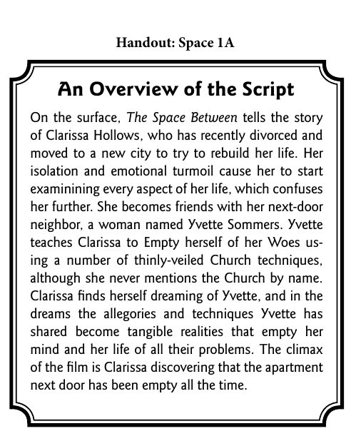
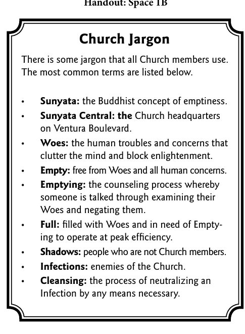

## Начальная сцена

Утро 8 апреля. С исчезновения Харроу 3 апреля на площадке неразбериха. Вудворд не закрыл производство. Под руководством второго режиссёра Текрупа Сингха вторая группа снимает досъёмочные планы, но в основном люди стараются выглядеть занятыми и гадают, заплатят ли им. Церковь прислала на площадку пиарщиков, юристов и «решал», чтобы справляться с дурной оглаской и юридическими осложнениями.

В начале игры сыщики собрались у стола с кофе и закусками. Это повод для игроков представить своих персонажей. Выдайте игрокам и раздатку «Пространство» 1 (части 1A, 1B и 1B (продолжение)) — в ней для справки собраны жаргон Церкви, краткое содержание сценария и список актёров и съёмочной группы. Дайте игрокам немного времени, чтобы освоиться с этими сведениями.

Все сыщики встречались друг с другом в какой-то момент съёмок. Даже те, кто не участвует в производстве, бывали на площадке по работе. При знакомстве стоит учесть это и описать не только внешность, но и любые подробности, которые могли заметить другие сыщики.

Можно сразу создать общую историю персонажей: попросите каждого игрока назвать одного сыщика, который помог ему по-новому понять учение Церкви, и другого, который был плохим примером церковных ценностей, — и объяснить почему.

### Текруп Сингх в отчаянии

Пока сыщики пьют кофе, к ним подходит Сингх и спрашивает, не слышал ли кто-нибудь из них о Вудворде. Сингх старается держаться молодцом и делает вид, будто для Вудворда такое поведение обычно, но, разговаривая, он дёрган и рассеян (успешная проверка Психологии покажет, что он раздосадован). В конце концов он уходит, так и не притронувшись к кофе.

Если в первый день ничто не нарушит застой, у Сингха случится срыв: он будет кричать на других членов группы и швыряться вещами. Он не раз скажет, что все в Церкви — сумасшедшие и что их мозги явно «опустели не так, как надо». Сингх потребует, чтобы кто-нибудь (тут вступают сыщики) вытащил Вудворда из квартиры и вернул его на площадку закончить работу. Он в ярости оттого, что Вудворд не отвечает на его звонки. А ещё он хотел бы, чтобы кто-нибудь выяснил, где же прячется Верити Харроу.

Хранитель может использовать Сингха, чтобы подтолкнуть сыщиков к действию. Он раздосадован и зол, так что сыщики — идеальная мишень, на которую можно давить.

> **Раздатка «Пространство» 1A**
>
> **Краткое содержание сценария**
>
> Внешне «Пространство между» рассказывает историю Клариссы Холлоуз, которая недавно развелась и переехала в новый город, чтобы попытаться начать жизнь заново. Одиночество и душевное смятение заставляют её пересматривать каждый уголок своей жизни, что запутывает её ещё больше. Она подружилась с соседкой, женщиной по имени Иветт Соммерс. Иветт учит Клариссу Опустошать себя от Горестей с помощью ряда едва замаскированных приёмов Церкви, хотя ни разу не называет Церковь. Клариссе начинает сниться Иветт, и во снах аллегории и приёмы, которыми делилась Иветт, становятся осязаемой реальностью, опустошающей её разум и жизнь от всех проблем. Кульминация фильма — Кларисса обнаруживает, что соседняя квартира всё это время была пуста.

<!-- -->

> **Раздатка «Пространство» 1B**
>
> **Жаргон Церкви**
>
> Есть жаргон, которым пользуются все члены Церкви. Самые распространённые термины перечислены ниже.
>
> - **Шуньята:** буддийское понятие пустоты.
> - **Шуньята-Центр:** штаб-квартира Церкви на бульваре Вентура.
> - **Горести:** человеческие тревоги и заботы, которые загромождают разум и мешают просветлению.
> - **Пустой:** свободный от Горестей и всех человеческих забот.
> - **Опустошение:** консультация, на которой человека проводят через разбор его Горестей и их отрицание.
> - **Полный:** переполненный Горестями и нуждающийся в Опустошении, чтобы действовать с наибольшей отдачей.
> - **Тени:** люди, не состоящие в Церкви.
> - **Инфекции:** враги Церкви.
> - **Очищение:** обезвреживание Инфекции любыми необходимыми средствами.
