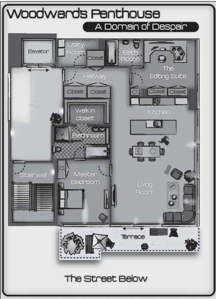

### Квартира Джареда Вудворда

Вудворд живёт в пентхаусе кондоминиума в Западном Голливуде, на Голливудском бульваре. Консьержи в форме знают сыщиков, которые регулярно бывают у Вудворда, но им строго велено никого не пускать наверх, пока Вудворд работает. Когда сыщики приходят впервые, за стойкой дежурит Мэнни — латиноамериканец средних лет с седеющими усами и печальными глазами. Мэнни приветлив, но исполнителен и вызовет полицию, если кто-нибудь попытается силой прорваться в дом Вудворда.

Чтобы подняться в квартиру Вудворда без его разрешения, нужна успешная проверка Красноречия или Запугивания; впрочем, Джулию Кортезе (готовую сыщицу) пропустят без вопросов.

Вудворд заперся в своей монтажной и одержимо работает, чтобы подготовить черновой монтаж фильма к тестовому показу вечером 9 апреля. Монтажная устроена в бывшей спальне.

Если ему не помешать, Вудворд будет монтировать всё время до показа. Фильм начинает изменять его восприятие и саму природу монтажной; большую часть времени, пока Вудворд работает, он заперт в этой иной реальности.

Тем, кто пришёл к Вудворду, придётся войти самим, если у них есть ключ (он есть у Джулии Кортезе), вскрыть замок или найти того, кто откроет им дверь, — например, консьержа. Из монтажной Вудворд не услышит стука в дверь: его сознание находится на базальтовых утёсах (см. «Монтажная»).

Если кто-нибудь позвонит Вудворду и попросит его открыть, он ответит, но будет испуган и бессвязен: скажет, что «Она» его не отпускает, и попросит не входить и не вмешиваться — «Ей» это не понравится. На любые вопросы о том, кто такая «Она», он отвечает рыданиями и смехом. Всё время разговора в трубке слышны ветер и шум прибоя, будто с пляжа.

Со времени ритуала Вудворд не спал и не мылся и жил на доставленной еде, водке и кокаине; его квартира это отражает. На полу валяются контейнеры из-под еды и грязные тарелки, ношеная одежда и пустые бутылки из-под водки. Шторы задёрнуты, и большая часть квартиры погружена в темноту. Стеклянный журнальный столик покрыт налётом белого порошка; на нём — изрядный пластиковый пакет кокаина, бритвенное лезвие и наполовину свёрнутая стодолларовая купюра. В воздухе висит запах испорченной еды и застарелого пота.

*Пентхаус Вудворда: обитель отчаяния. Подписи плана: Elevator — лифт; Hall — холл у лифта; Stairwell — лестничная клетка; Hallway — коридор; Utility Room — подсобка; Closet / Cl — кладовка; Walk in closet — гардеробная; Bath Room / Bathroom — ванная; The Editing Suite — монтажная; Kitchen — кухня; Master Bedroom — хозяйская спальня; Living Room — гостиная; Terrace — терраса; The Street Below — улица внизу.*

### Монтажная

Всякий, кто бывал в квартире Вудворда, знает, какая комната — монтажная. Дверь закрыта, и из-за неё не доносится ни звука. Металлическая дверная ручка неестественно холодна на ощупь и покрыта инеем. Тот, кто постучит в дверь, ничего не услышит: костяшки пальцев стучат по дереву двери
