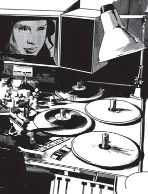

> **Базальтовые утёсы**
>
> Эпизоды сна в «Пространстве между» происходят в естественном амфитеатре на вершине громадного чёрного утёса. Стены амфитеатра — из стекловидного чёрного камня, слишком гладкие и высокие, чтобы на них взобраться. Стены образуют полукруг, а открытый край смотрит вниз, на зазубренные чёрные скалы в сотне с лишним метров под ним. Тёмное море, очерченное жутким свечением, разбивается о скалы, посылая клочья холодной белой пены к звёздным небесам.
>
> Небо над утёсами полно звёзд, но они не складываются ни в одно знакомое созвездие (проверка Знаний или Астрономии). Если понаблюдать за небом несколько минут, видно, что звёзды медленно движутся, беспорядочно дрейфуя, как пыльца на воде.
>
> Всякий раз, когда человек сталкивается с утёсами, они быстро захватывают все его чувства. Тот, кто смотрит на них на плёнке, вдруг ощущает запах моря и холод ветра. Темнота утёсов и неба над ними заполняет края его поля зрения, а потом не остаётся ничего, кроме утёсов. Пережить такое — проверка Рассудка (1/1d8).

*Монтажная*

беззвучно, хотя на ощупь дерево совершенно обычное (проверка Рассудка, 0/1).

Дверь не заперта. В комнате темно, лишь мерцают какие-то огоньки. Оттуда дует холодный воздух. Пахнет озоном или морем. Если нашаривать выключатель, рука нащупает лишь пустоту. Вудворд не откликается на зов, а голос сыщика отдаётся жутким эхом.

Переступив порог монтажной, сыщик оказывается на базальтовых утёсах (см. врезку «Базальтовые утёсы»). Примерно в 100 метрах впереди видно Вудворда, стоящего на коленях на чёрном камне. Перед ним стоит Иветт Соммерс (см. с. 186) с бесстрастным лицом. Вудворд опустил голову и рыдает, умоляя её пощадить его. Увидеть эту сцену — проверка Рассудка (0/1d2).

Позади сыщика, там, где была дверь, — отвесная стена из стекловидного чёрного камня. Как только сыщик обнаружит своё присутствие, Вудворд бросится к нему, умоляя о помощи. Он объясняет, что не готов, что больше не хочет быть Пустым — теперь, когда увидел, что это значит на самом деле. Тем временем Иветт Соммерс медленно идёт к сыщику.

Разрешить эту ситуацию можно несколькими способами:

- Если сыщик сразу отпрянет назад, войдя в комнату, прежде чем привлечёт внимание Иветт Соммерс, он окажется снова в коридоре квартиры Вудворда.
- Если кто-то снаружи откроет дверь монтажной после того, как Вудворда отвлекли от Иветт Соммерс, чары рассеются, и сыщик, который был на утёсах, окажется в монтажной вместе с перепуганным Вудвордом.
- Если сыщик попытается усилием воли вырваться с утёсов, попросите игрока пройти проверку МОЩ. При успехе реальность утёсов тает, и сыщик с Вудвордом снова оказываются в монтажной.
- Когда Иветт Соммерс подойдёт к сыщику вплотную, Вудворд схватит его за руку и побежит к обрыву. Он попытается утащить сыщика за край, на зазубренные скалы и в прибой внизу. Если сыщик подчинится, оба через некоторое время придут в себя на полу монтажной. Если сыщик хочет вырваться, чтобы его не утащили на, по всей видимости, верную смерть, проведите встречную проверку СИЛ против СИЛ 40.

Если ни один из этих способов не сработал, сыщик оказывается во власти Иветт Соммерс. Действуйте по указаниям из раздела о ней (с. 186), включая проверку Рассудка (1/1d8) при виде её истинного облика, а затем, скорее всего, обратитесь к врезке «Как играть Опустошённым».

Если кто-нибудь снова войдёт в монтажную, она окажется обычной комнатой; главное место в ней занимает большой монтажный стол «Стенбек» с заправленной 35-мм плёнкой. В стол встроен экран с подсветкой, на котором виден кадр
