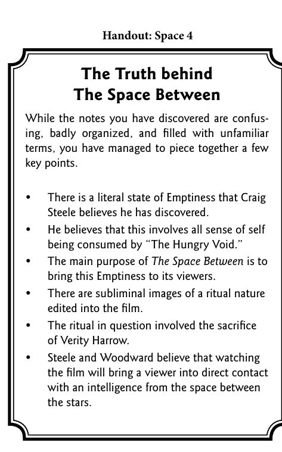

> **Как играть Опустошённым**
>
> Одного или нескольких сыщиков могут Опустошить по ходу игры. Почти во всех важных отношениях это означает смерть сыщика, но выводить персонажа из игры незачем.
>
> Пустые персонажи бывают двух видов: Опустошённые и Истинно Пустые. Если сыщика Опустошили ускоренной хирургической процедурой, он становится Опустошённым. Если его коснулась Иветт Соммерс — Истинно Пустым. Выдайте игроку соответствующую раздатку («Пространство» 2 или 3).
>
> Считайте Опустошённых сыщиков бессрочно безумными: в них ещё осталось достаточно человеческого, чтобы страдать. Истинно Пустые выше этого: разум, наполняющий их кожу, не знает, что такое безумие, поэтому проверки Рассудка им проходить не нужно.

Кларисса Холлоуз встречает Иветт Соммерс на базальтовых утёсах. Если смотреть на изображение достаточно долго, Иветт Соммерс поворачивается к зрителю и идёт вперёд — проверка Рассудка (1/1d6).

В комнате беспорядок, повсюду разбросаны открытые коробки с плёнкой. Стол завален кусками плёнки, которые Вудворд монтировал вручную — канцелярским ножом и клейкой лентой. Несколько отдельных кадров выделяются: основной цвет в них — красный. Если присмотреться, это крупные планы обнажённой женщины, лежащей ничком, с чьей спины большим изогнутым ножом сдирают кожу (проверка Рассудка, 0/1d4). Рамка каждого такого кадра расписана крошечными сигилами. Сбоку стоит маленькая металлическая миска с чем-то похожим на кровь; на её краю лежит тонкая кисточка, а рядом — ювелирная лупа.

В монтажной есть и ноутбук Вудворда в кожаном чехле. Он защищён паролем, но проверка Работы с компьютером позволит его обойти. В одной из папок на ноутбуке — подробные производственные заметки «Пространства между», некоторые из которых касаются истинного назначения фильма и связанных с ним ритуалов. Копии большинства этих документов есть и у Стила с Масгроувом.

Чтобы быстро просмотреть эти документы, нужна проверка Родного языка (английского). При успехе — или если сыщик скопирует файлы и спокойно прочтёт их в другом месте — выдайте игроку раздатку «Пространство» 4 «Правда о „Пространстве между“».

> **Раздатка «Пространство» 4**
>
> **Правда о «Пространстве между»**
>
> Найденные вами заметки запутаны, плохо упорядочены и полны незнакомых терминов, но несколько ключевых моментов вам удалось сложить.
>
> - Существует буквальное состояние Пустоты, которое, как верит Крейг Стил, он открыл.
> - Он верит, что при этом всё ощущение себя поглощает «Голодная Пустота».
> - Главная цель «Пространства между» — нести эту Пустоту зрителям.
> - В фильм вмонтированы подсознательные образы ритуального характера.
> - Ритуал, о котором идёт речь, включал жертвоприношение Верити Харроу.
> - Стил и Вудворд верят, что просмотр фильма приводит зрителя в прямой контакт с разумом из пространства между звёздами.

## Штаб-квартира Церкви

Главная штаб-квартира Церкви Шуньяты занимает десятиэтажное здание из стекла и стали на бульваре Вентура. В этом конторском здании, которое в обиходе называют Шуньята-Центром, размещается всемирная администрация Церкви; здесь работает больше пятисот человек.

Три нижних этажа отданы под семинарские аудитории, переговорные, комнаты Опустошения и разные экспозиции об учении Церкви. Есть внутренний двор с атриумом, в центре которого — фонтан: вода струится по стеклянной сфере посередине, и кажется, будто это огромный пузырь.

Любой желающий может зайти в здание, чтобы узнать о Церкви, а снаружи обычно стоят вербовщики, зазывающие прохожих. Члены Церкви могут прийти на сеанс Опустошения в любое время — лишь бы платили.

### Бесплатный сеанс Опустошения

Когда сыщики впервые придут в штаб-квартиру, их восторженно встретит Рич Валларио, который работает на площади перед зданием, приглашая людей на бесплатные пробные сеансы Опустошения. Валларио — активный волонтёр; он безуспешно пытался устроиться на съёмки «Пространства между».

Валларио всё ещё отчаянно хочет участвовать в производстве, но его тревожат кое-какие вещи, которые он недавно видел. Ради того и другого он постарается уговорить кого-нибудь из сыщиков пройти с ним сеанс Опустошения — бесплатно, по личной дружбе со своим «очень хорошим другом».
