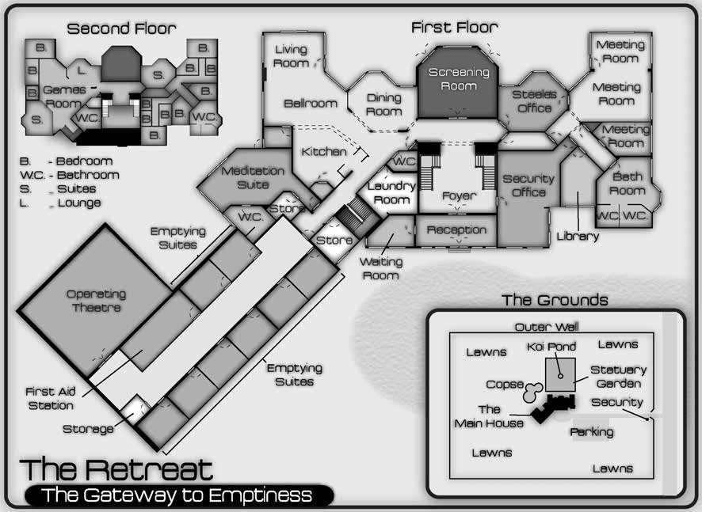

*Ретрит знаменитостей: врата в Пустоту. Подписи плана:*

- *The Grounds — территория: Outer Wall — наружная стена; Lawns — лужайки; Koi Pond — пруд с кои; Statuary Garden — сад статуй; Copse — роща; Security — пост охраны у ворот; Parking — парковка; The Main House — главное здание.*
- *First Floor — первый этаж: Foyer — фойе; Reception — ресепшен; Security Office — служба охраны; Living Room — гостиная; Ballroom — бальный зал; Dining Room — столовая; Screening Room — просмотровый зал; Steeles Office — кабинет Стила; Meeting Room — переговорная; Library — библиотека; Kitchen — кухня; Laundry Room — прачечная; Store — кладовая; Bath Room — ванная; W.C. — туалет; Meditation Suite — комната для медитации; Waiting Room — зал ожидания; Emptying Suites — комнаты Опустошения; Operating Theatre — операционная; First Aid Station — медпункт; Storage — склад.*
- *Second Floor — второй этаж: B. — спальня; L. — гостиная; S. — люкс; Games Room — игровая; W.C. — туалет.*
