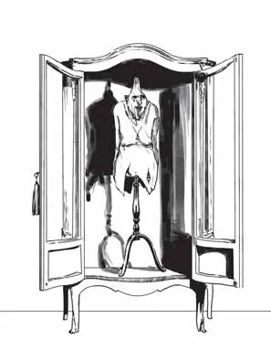

человека. Пока что его подопытных затягивало в бутылку, и они пропадали навсегда, так что приходилось заметать следы и платить за молчание. Если бутылку разбить или откупорить, Пустота вырвется наружу — см. «Голодная Пустота» (с. 186).

Масгроув проводит в кабинете почти всё время: ему больше не нужно ни спать, ни есть, ни выполнять какие-либо иные телесные отправления. Большинство встреч он проводит по телефону, так что обычно его можно застать за столом. Когда ничто не требует его внимания, он сидит совершенно неподвижно — он не дышит.

## Ретрит знаменитостей

Особняк, в котором размещается Ретрит знаменитостей, построен в 1920-х годах; в нём жили знаменитые люди. Церковь Шуньяты купила его в 1987 году. Ретрит стоит на участке около 1,6 га, среди лужаек, сада статуй, пруда с кои и рощи японских вишен. Здесь тихо и умиротворённо — если не считать пятиметровых каменных стен вокруг усадьбы и патрулей вооружённой охраны.

Главный въезд на территорию — железные ворота с электроприводом. В будке у ворот всегда дежурит охранник. Из-за подготовки к тестовому показу все посетители должны получить разрешение Стила или Масгроува.

Главное здание выстроено в испанском колониальном стиле: два основных этажа, белые оштукатуренные стены и крыша из красной черепицы. На нижнем этаже — административные помещения, бальный зал, просмотровый зал, библиотека и столовая, а наверху — несколько спален для гостей. Внутренние стены — белая штукатурка, комнаты обставлены антиквариатом.

Северное крыло, построенное в конце 1990-х, занимают комнаты Опустошения, камеры сенсорной депривации и комнаты для медитации. Его архитектура не сочетается с первоначальным зданием и выглядит современнее. Стены выкрашены в стерильно-белый или пастельные цвета. Повсюду пахнет сандалом.

### Ресепшен

За стойкой ресепшена всегда кто-то дежурит, чтобы заботиться о нуждах гостей; администратор служит узлом связи для всего комплекса.

Приёмная отделена от остального здания стеклянными дверями: посетители видят коридор за ними, но не могут войти, пока администратор не откроет замок. Приёмная обставлена пухлыми белыми диванами и креслами. На столиках со стеклянными столешницами лежат церковная литература и старые номера «Вэрайети». Стены увешаны фотографиями знаменитостей — членов Церкви, а одну стену занимает написанный маслом портрет

*Кожа Ральфа Л. Чандлера*

Ральфа Л. Чандлера в форме военно-воздушных сил.

Запертая стальная дверь ведёт в комнату охраны; у неё есть и вторая дверь во внутренний коридор. Администратор может вызвать охрану звонком, а видеокамеры следят за всей приёмной.

Стойка ресепшена большая и современная, из стекла и стали. Мэнди Солек, молодая женщина, дежурящая, когда приходят сыщики, бойкая, жизнерадостная и профессиональная. Она встречает гостей вопросом: «Чем я могу сделать ваш день чудесным?» — и сверкает ровными, ухоженными зубами.

Если сыщики приехали не на тестовый показ, Солек должна получить разрешение Стила, прежде чем пустить их дальше. Она позвонит ему по внутреннему телефону (Стил больше не спит, так что доступен в любое время), и он будет настаивать, что сам проводит сыщиков.

### Охрана

В Ретрите знаменитостей постоянно работают 30 охранников, и не меньше шести из них дежурят в любое время. Все охранники обучены — некоторые раньше служили в полиции — и все состоят в Церкви. Они носят пистолеты и электрошокеры; главный их приказ — задерживать нарушителей и смутьянов, но им разрешено применять смертоносную силу. Используйте характеристики охранника Церкви (с. 205).

Каждый квадратный метр Ретрита просматривается камерами наблюдения, но камеры в комнатах Опустошения, операционной и личном кабинете Стила не передают изображение в главную комнату охраны; их записи можно
