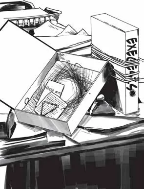

просмотреть только с компьютера Стила.

> **Экзегеза Ральфа Л. Чандлера**
>
> Этот труд Мифов — пять больших потрёпанных картонных коробок-папок с рукописными и машинописными страницами, непостижимыми схемами и вырезками из других источников. Стил пытался составить указатель и краткое изложение, но записи всё равно безумно хаотичны.
>
> - Потеря Рассудка: 1d8
> - Мифы Ктулху: +2% начальное чтение; +5% полное изучение
> - Значение Мифов: 30
> - Изучение: 40 недель
>
> Заклинания: «Врата в Пустоту» (Вызов/изгнание Йог-Сотота), «Общение с Приносящим Мудрость» (Связь с божеством: Ньярлатхотеп).

*Экзегеза Ральфа Л. Чандлера*

### Личный кабинет Крейга Стила

Стил занимает тот же кабинет, что и Чандлер в свои последние годы. Он обставлен антиквариатом: здесь стол красного дерева, персидский ковёр и большая бронзовая статуя Будды. Стены от пола до потолка заставлены книжными полками с церковными изданиями, книгами по религии и философии и сотнями переплетённых тетрадей, которые Чандлер исписал от руки.

Среди более безобидных книг — два труда Мифов: потрёпанный неполный экземпляр «Сассекской рукописи» (см. «Книгу хранителя») и подборка папок с главной частью разбора этой книги Чандлером и его собственными выводами о природе Пустоты и Голодной Пустоты (см. «Экзегеза Ральфа Л. Чандлера»).

В углу комнаты стоит дубовый шкаф с тяжёлым стальным замком. Внутри — манекен, на котором надета выделанная кожа Ральфа Л. Чандлера. Чандлер просил сохранить свою кожу, так как верил, что Опустошение возможно и после смерти. Стил работает над тем, чтобы воскресить Чандлера Истинно Пустым.

Компьютер на столе Стила защищён паролем, но его можно взломать трудной проверкой Работы с компьютером. Тогда откроется доступ к изображению с камер наблюдения во всём здании, к досье службы безопасности на членов Церкви (в том числе на сыщиков) и к заметкам о разработке и сценарии «Пространства между». Чтобы просмотреть эти заметки и уловить суть, нужна проверка Родного языка (английского). При успехе — или если сыщик скопирует файлы и спокойно прочтёт их в другом месте — выдайте игроку раздатку «Пространство» 4 «Правда о „Пространстве между“».

Если кто-нибудь из сыщиков вёл себя подозрительно, Стил сам выйдет с ним на связь. Внешне его интересует производство, но на самом деле он хочет выяснить, насколько опасен этот человек. Любому такому подозреваемому Стил скажет, что напряжение из-за вставшего производства и полицейского расследования, должно быть, «переполняет его Горестями», и предложит сыщику личный сеанс Опустошения (см. «Личный сеанс у Стила», с. 200).

### Комнаты Опустошения

Сеанс Опустошения — где бы он ни проходил, в Ретрите знаменитостей или нет, — это в основном череда вопросов, призванных заставить человека открыть, что у него на душе. Сеансы проводятся один на один, и Опустошающий должен быть обучен одобренным Церковью методам.

Сеансы проходят в отдельных комнатах и считаются строго конфиденциальными. Однако все комнаты в Ретрите знаменитостей прослушиваются, и каждый сеанс записывается без ведома того, кого Опустошают. Записи сеансов хранятся на случай, если когда-нибудь понадобится на этого человека надавить.

В комнатах чисто и тихо: белые стены, мягкая белая мебель. Звучит фоновая музыка нью-эйдж, но с началом сеанса её выключают. Дверь каждой комнаты снабжена замком; запирают их редко, но если Стил уведёт сыщика в такую комнату, он запрёт их обоих внутри.
