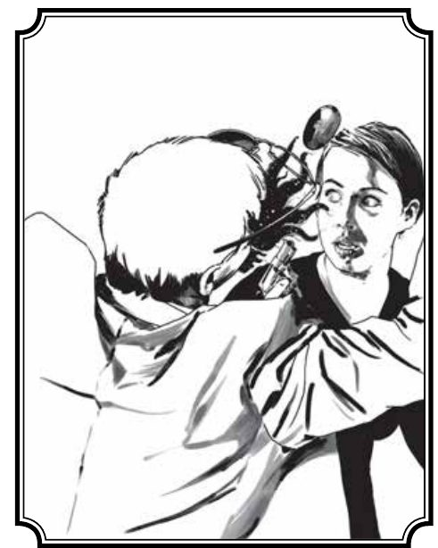
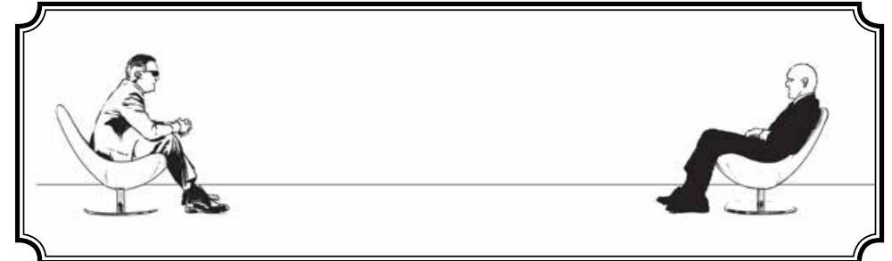

*Личный сеанс у Стила*

### Личный сеанс у Стила

Если сыщик вёл себя подозрительно (задавал много вопросов, рыскал по Ретриту, разговаривал с Харроу и так далее), Стил захочет выяснить, не угрожает ли он тестовому показу и будущему выходу «Пространства между».

Стил вызовет сыщика к себе в кабинет и спросит, не чувствует ли тот себя немного «Полным», ведь его «Горести явно мешают ему действовать с полной отдачей». Значит, сыщику давно пора на сеанс Опустошения, и Стил будет только рад провести его сам. Он будет участлив и сердечен, давая понять, что сеанс Опустошения у него лично — большая честь, которая поднимет положение сыщика в Церкви.

Если сыщик откажется, Стил дождётся, пока тот отойдёт подальше, и вызовет охрану, чтобы его задержали. Если сыщик не сбежит, его отведут в операционную для «Ускоренного пути» (с. 201). Попытку побега можно разыграть по правилам погони (см. «Побег из Ретрита знаменитостей», с. 201).

Если сыщик согласится на личный сеанс, Стил отведёт его в свободную комнату и запрёт дверь. Он предложит сыщику устроиться поудобнее, а затем ровным, успокаивающим голосом начнёт задавать вопросы. Сначала вопросы мягкие: какие Горести занимают мысли сыщика, не добавляют ли ему Горестей неурядицы на площадке, что он думает об исчезновении Харроу и так далее. Если Стилу известно о каких-то поступках сыщика, он сосредоточится на них и спросит, например, какие Горести заставили его проникнуть в закрытую зону.

Стил умеет читать реакции собеседников, так что лгать ему трудно. Любая попытка солгать требует трудной проверки Красноречия. Если сыщик пройдёт сеанс, ни разу не попавшись на лжи, Стил просто отпустит его с дружеским напоминанием больше не позволять себе становиться таким «Полным». Ещё Стил попросит отныне сообщать лично ему обо всём, о чём ему следует знать.

Если Стил убедится, что сыщик лжёт, он извинится и выйдет вызвать охрану, чтобы сыщика задержали и отвели в операционную. Дверь довольно надёжна: чтобы её отпереть, нужна проверка Взлома, а чтобы выломать — трудная проверка СИЛ; последнее привлечёт внимание.

### Операционная

В дальнем конце Северного крыла есть небольшая клиника, где всегда дежурит врач. Месяц назад Стил велел оборудовать одну из комнат клиники под операционную и с тех пор ставит там опыты с насильственным Опустошением. В операционной есть скальпели, ножи для свежевания, пилы для костей и зажимы.

*Комната Опустошения*
