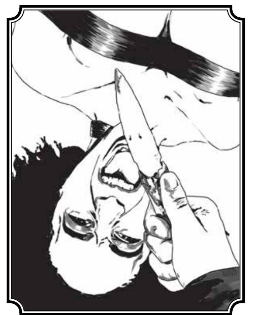

На лезвиях некоторых ножей вырезаны странные сигилы (успешная проверка Мифов Ктулху покажет, что они, возможно, связаны с Открывателем Пути).

Середину комнаты занимает стол из нержавеющей стали с кожаными ремнями для фиксации и стоками по обеим сторонам. На металле стола вырезаны такие же сигилы, как на ножах. Газовых баллонов и анестетиков в комнате нигде не видно, но есть столик с несколькими стеклянными банками странных жидкостей и порошков и медная миска, потемневшая от пятен крови. У одной стены стоят несколько больших контейнеров для медицинских отходов.

### «Ускоренный путь»

Придуманный Стилом способ таков: на кожу человека наносят сигилы смесью крови, пепла и толчёного метеорита. Затем человека хирургически ослепляют и лишают слуха, чтобы оградить от посторонних ощущений, а после ритуально свежуют. Очень важно, чтобы всё это время человек был жив и в сознании.

Если Стил считает сыщика угрозой будущему «Пространства между», он объяснит, что Церковь разрабатывает новые приёмы, помогающие людям стать Пустыми без многолетних занятий и практики, и спросит, не хочет ли сыщик попробовать один из них.

Если сыщик согласится, Стил отведёт его в операционную. Двери операционной открыты; внутри человек в хирургическом костюме надевает бумажную маску. Он стоит у стального операционного стола.

Успешная проверка Внимания позволит заметить двух охранников, которые на почтительном расстоянии следуют за сыщиком. Стил велел им при необходимости его скрутить.

Если сыщик не сбежит от охранников — или если согласится на Опустошение даже после того, как увидит операционную, — его разденут догола и привяжут к операционному столу. Перед процедурой и хирург, и Стил словно молятся на незнакомом языке. Затем хирург выбирает один из очень острых ножей и начинает долгий процесс снятия кожи с живого сыщика. Обезболивания нет.

Когда процедура закончена, выдайте игроку раздатку «Пространство» 2 «Вас Опустошили».

### Побег из Ретрита знаменитостей

Скорее всего, в какой-то момент сыщик захочет бежать из Ретрита знаменитостей — особенно если его выбрали для «Ускоренного пути». Как это разыграть, во многом зависит от того, может ли он ещё ускользнуть тихо или тревога уже поднята.

Конечно, если сыщик не дал ни Стилу, ни кому-либо ещё в Ретрите повода для подозрений, его спокойно отпустят.

*«Ускоренный путь» к Пустоте*

#### Тихий уход

Если тревога не поднята, можно попытаться покинуть Ретрит незаметно. Успешная проверка Скрытности позволит сыщику незамеченным добраться до наружного окна или двери в приёмную. Камеры всё равно его запишут, но никто этого не заметит, пока не станет слишком поздно.

Если открыть наружное окно — или, хуже того, разбить его, — сработает сигнализация, и через 1d6+1 раундов на место прибудут охранники. Это касается и французских окон столовой, и пожарных дверей в коридорах. Проверка Электрики позволит сыщику отключить датчики на двери или окне и избежать этого. Если охранник застанет сыщика за тем, что тот включил сигнализацию, нужна трудная проверка Красноречия, чтобы убедить его, что этому есть невинное объяснение.

Снаружи нужна проверка Удачи, чтобы определить, не патрулирует ли сад охранник. Если охранник есть, сыщику придётся либо подождать, пока тот уйдёт, либо пройти проверку Скрытности, чтобы прокрасться мимо.

Чтобы перелезть через наружную стену, не напоровшись на колючую проволоку и битое стекло наверху, нужна трудная проверка Лазания. Провалив её, сыщик получает 1d3 урона и должен пройти проверку Удачи, чтобы не вскрикнуть и не всполошить охрану.

Чтобы выйти через главные ворота, нужно либо не попасться на глаза охраннику у ворот — например, спрятавшись на заднем сиденье чьей-нибудь уезжающей машины, — либо убедить охранника, что подозревать нечего; для этого нужна проверка Красноречия.
