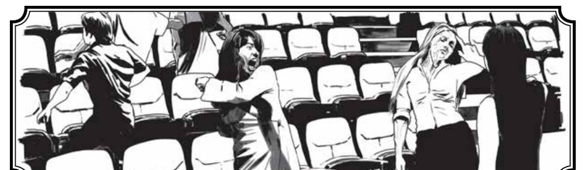

*Тестовый показ*

Посреди всего этого Иветт Соммерс, представшая в своём истинном облике, спокойно идёт сквозь толпу, касаясь людей и Опустошая их. Звёзды с кружащегося неба спускаются вихрями и водоворотами и входят в опавшие оболочки кожи. Эти оболочки снова надуваются, как воздушные шары, поднимаются на ноги и оглядываются тёмными глазами, полными звёзд.

Реальность базальтовых утёсов в просмотровом зале куда сильнее, чем в монтажной Вудворда. Пережить происходящее, не будучи Опустошённым, сыщику почти не удастся. Можно спрятаться от Иветт Соммерс (трудная проверка Скрытности) или прыгнуть с утёсов и пройти трудную проверку МОЩ, чтобы вырваться обратно в реальность. Тот, кто прыгнул и провалил проверку, погибает, разбившись о зазубренные скалы в сотне с лишним метров внизу. Если игрок придумает творческий способ спастись (например, с помощью навыка Мифы Ктулху), будьте открыты к этой возможности, но помните, что он пытается сбежать от богоподобного существа.

Если сыщик не бежит и не прячется, Иветт Соммерс неизбежно до него доберётся. Даже если он попытается убежать, вскоре Истинно Пустых станет намного больше, и они будут держать сыщика, пока Иветт Соммерс не примет его в их ряды. Не разыгрывайте раунд за раундом попытки сыщика убежать — это только раздосадует игроков; просто перескочите к тому, как его держат Истинно Пустые, а он смотрит, как Иветт Соммерс неумолимо приближается к нему.

Сыщик, которому удалось спрятаться, обнаружит, что после, казалось бы, целой вечности просмотровый зал возвращается в прежний вид, хотя на самом деле прошло всего 20 минут. Тот, кто вырвался прыжком, очнётся растерянным и сбитым с толку на полу просмотрового зала.

Зал полон остальных зрителей; все сидят на своих местах, спокойные. Когда сыщики поднимаются, остальные оборачиваются к ним, и их тёмные глаза полны звёзд…

## Развязка

Определённой финальной сцены нет: игроки могут повлиять на исход множеством способов. Постарайтесь найти подходящий жуткий или сильный кульминационный момент и закончить на нём — можно попросить игроков коротко рассказать эпилог для каждого выжившего персонажа, отразив в нём их успехи или неудачи в сдерживании угрозы, исходящей от фильма. Ниже приведены несколько частых исходов, встречавшихся при тестовых играх.

### Уничтожение фильма

Фильм — серьёзное уязвимое место в замысле Церкви. Есть и другой отснятый материал, из которого можно смонтировать его заново, но для этого нужен Вудворд. После всего, что он пережил и сделал, Вудворд, закончив черновой монтаж, больше не захочет иметь с Церковью ничего общего.

Если убить Вудворда, вывести его из строя или отговорить его до того, как он закончит черновой монтаж, это тоже вставит палки в колёса, но может навлечь на сыщиков уголовные обвинения или месть Церкви.

Если станет известно, что за уничтожением фильма стоят сыщики, Стил и Масгроув пустят все ресурсы Церкви на то, чтобы их выследить. Лучше всего для них было бы вернуть сыщиков в Ретрит знаменитостей для «Ускоренного пути», но Церковь удовольствуется и тем, чтобы разорить их или убить.

### Помощь полиции

При том влиянии, которое Церковь имеет в Лос-Анджелесе, помощь полиции вряд ли закончится хорошо. Сыщики со связями в полиции могут пройти трудную проверку Психологии, чтобы понять, можно ли доверять знакомым полицейским; при провале кто-нибудь из Церкви получит наводку, где находятся сыщики.

Если у сыщиков есть доказательства преступлений, полиция может взять их под защиту, но Церковь достаточно сильна, чтобы затормозить любое расследование и затянуть
