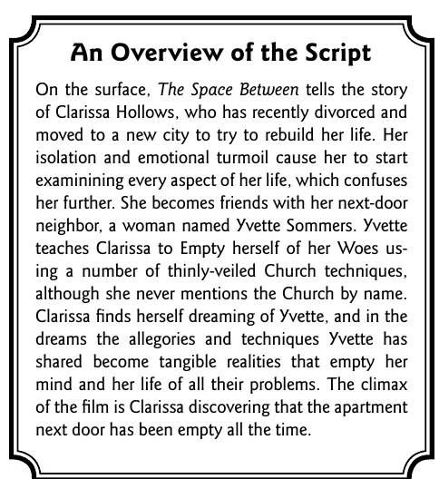
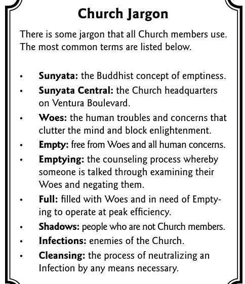
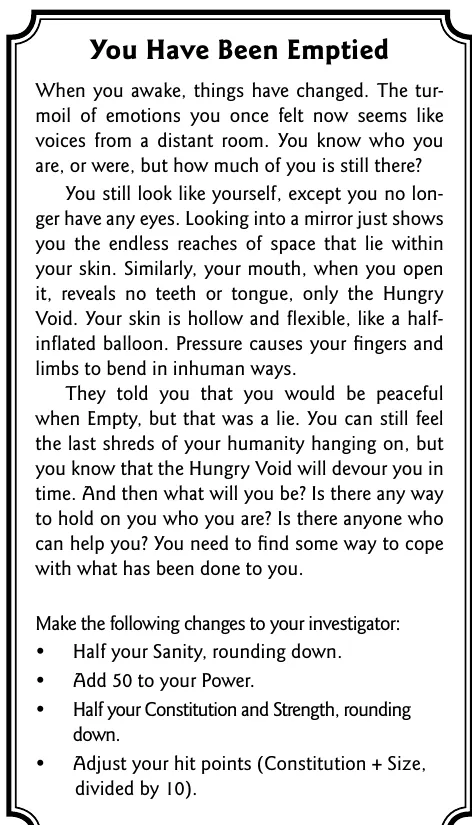

# Приложение B. Раздатки

> **Раздатка «Пространство» 1A**
>
> **Краткое содержание сценария**
>
> Внешне «Пространство между» рассказывает историю Клариссы Холлоуз, которая недавно развелась и переехала в новый город, чтобы попытаться начать жизнь заново. Одиночество и душевное смятение заставляют её пересматривать каждый уголок своей жизни, что запутывает её ещё больше. Она подружилась с соседкой, женщиной по имени Иветт Соммерс. Иветт учит Клариссу Опустошать себя от Горестей с помощью ряда едва замаскированных приёмов Церкви, хотя ни разу не называет Церковь. Клариссе начинает сниться Иветт, и во снах аллегории и приёмы, которыми делилась Иветт, становятся осязаемой реальностью, опустошающей её разум и жизнь от всех проблем. Кульминация фильма — Кларисса обнаруживает, что соседняя квартира всё это время была пуста.

<!-- -->

> **Раздатка «Пространство» 1B**
>
> **Жаргон Церкви**
>
> Есть жаргон, которым пользуются все члены Церкви. Самые распространённые термины перечислены ниже.
>
> - **Шуньята:** буддийское понятие пустоты.
> - **Шуньята-Центр:** штаб-квартира Церкви на бульваре Вентура.
> - **Горести:** человеческие тревоги и заботы, которые загромождают разум и мешают просветлению.
> - **Пустой:** свободный от Горестей и всех человеческих забот.
> - **Опустошение:** консультация, на которой человека проводят через разбор его Горестей и их отрицание.
> - **Полный:** переполненный Горестями и нуждающийся в Опустошении, чтобы действовать с наибольшей отдачей.
> - **Тени:** люди, не состоящие в Церкви.
> - **Инфекции:** враги Церкви.
> - **Очищение:** обезвреживание Инфекции любыми необходимыми средствами.

<!-- -->

> **Раздатка «Пространство» 2**
>
> **Вас Опустошили**
>
> Когда вы приходите в себя, всё изменилось. Буря чувств, которую вы когда-то испытывали, теперь кажется голосами из далёкой комнаты. Вы знаете, кто вы — или кем были, — но сколько от вас ещё осталось?
>
> Вы выглядите как прежде, только глаз у вас больше нет. В зеркале видны лишь бесконечные просторы космоса, лежащие внутри вашей кожи. Так же и рот: открыв его, вы видите не зубы и язык, а лишь Голодную Пустоту. Ваша кожа полая и гибкая, как полунадутый воздушный шар. От нажима пальцы и конечности гнутся нечеловечески.
>
> Вам говорили, что, став Пустыми, вы обретёте покой, но это была ложь. Вы ещё чувствуете, как цепляются последние клочья вашей человечности, но знаете, что со временем Голодная Пустота пожрёт вас. И чем вы тогда станете? Можно ли как-то удержать себя? Может ли кто-нибудь вам помочь? Нужно найти способ справиться с тем, что с вами сделали.
>
> Внесите в лист сыщика следующие изменения:
>
> - Уменьшите Рассудок вдвое, с округлением вниз.
> - Прибавьте 50 к МОЩ.
> - Уменьшите ВЫН и СИЛ вдвое, с округлением вниз.
> - Пересчитайте ПЗ ((ВЫН + ТЕЛ) / 10).
