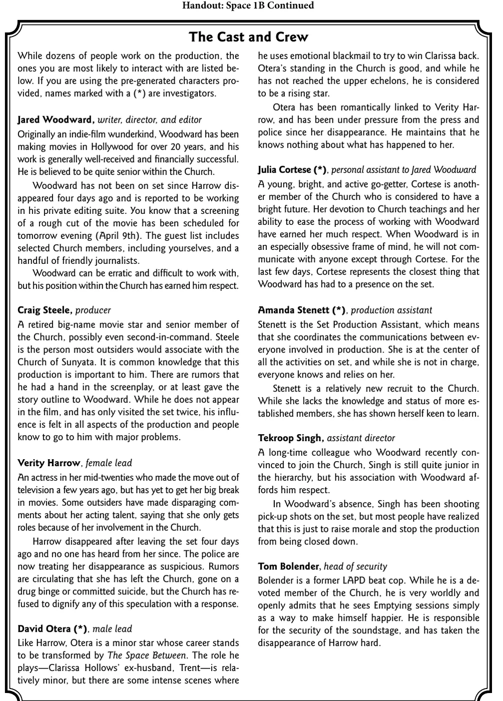

> **Раздатка «Пространство» 1B (продолжение)**
>
> **Актёры и съёмочная группа**
>
> На съёмках работают десятки людей, но чаще всего вы будете иметь дело с теми, кто перечислен ниже. Если вы играете готовыми сыщиками из книги, имена со звёздочкой (\*) — сыщики.
>
> **Джаред Вудворд**, *сценарист, режиссёр и монтажёр*
>
> Начинал как вундеркинд независимого кино; больше 20 лет снимает в Голливуде, его фильмы обычно хорошо принимают, и они приносят доход. Считается, что он занимает в Церкви довольно высокое положение.
>
> Вудворд не появлялся на площадке с исчезновения Харроу четыре дня назад; говорят, он работает в своей личной монтажной. Вы знаете, что показ чернового монтажа фильма назначен на завтрашний вечер (9 апреля). В списке гостей — избранные члены Церкви, в том числе вы, и горстка дружественных журналистов.
>
> С Вудвордом бывает трудно работать, он непредсказуем, но положение в Церкви принесло ему уважение.
>
> **Крейг Стил**, *продюсер*
>
> Бывшая кинозвезда первой величины и высокопоставленный член Церкви, возможно, даже второй человек в ней. Для большинства посторонних Стил и есть Церковь Шуньяты. Всем известно, что этот фильм для него важен. Ходят слухи, что он приложил руку к сценарию или хотя бы дал Вудворду синопсис. Сам он в фильме не снимается и был на площадке лишь дважды, но его влияние чувствуется во всём, и все знают, что с серьёзными проблемами идут к нему.
>
> **Верити Харроу**, *исполнительница главной роли*
>
> Актриса лет двадцати пяти, несколько лет назад перешедшая из телевидения в кино, но ещё не получившая большого прорыва. Некоторые посторонние пренебрежительно отзываются о её таланте: мол, роли ей дают только из-за её связи с Церковью.
>
> Четыре дня назад Харроу ушла с площадки и пропала, с тех пор о ней ничего не слышно. Теперь полиция считает её исчезновение подозрительным. Ходят слухи, что она ушла из Церкви, ушла в наркотический загул или покончила с собой, но Церковь отказывается удостаивать эти домыслы ответом.
>
> **Дэвид Отера (\*)**, *исполнитель главной мужской роли*
>
> Как и Харроу, Отера — звезда второго плана, чью карьеру должно преобразить «Пространство между». Его роль — бывший муж Клариссы Холлоуз, Трент, — сравнительно небольшая, но в ней есть напряжённые сцены, где он эмоциональным шантажом пытается вернуть Клариссу. Положение Отеры в Церкви хорошее: верхних эшелонов он не достиг, но считается восходящей звездой.
>
> С Отерой связывали роман с Верити Харроу, и после её исчезновения на него давят пресса и полиция. Он твердит, что ничего не знает о том, что с ней случилось.
>
> **Джулия Кортезе (\*)**, *личная помощница Джареда Вудворда*
>
> Молодая, умная и энергичная, Кортезе — ещё один член Церкви, которому прочат блестящее будущее. Преданность учению Церкви и умение облегчать работу с Вудвордом принесли ей большое уважение. Когда Вудворд в особенно одержимом настроении, он общается с людьми только через Кортезе. Последние несколько дней Кортезе — самое близкое к присутствию Вудворда на площадке.
>
> **Аманда Стеннетт (\*)**, *ассистент по производству*
>
> Стеннетт — ассистент по площадке: она координирует связь между всеми участниками производства. Она в центре всего, что происходит на площадке, и, хотя не руководит, все её знают и на неё полагаются.
>
> Стеннетт — сравнительно новый член Церкви. Ей не хватает знаний и положения старожилов, но она показала, что стремится учиться.
>
> **Текруп Сингх**, *второй режиссёр*
>
> Давний коллега, которого Вудворд недавно уговорил вступить в Церковь; Сингх ещё довольно низко в иерархии, но связь с Вудвордом даёт ему уважение.
>
> В отсутствие Вудворда Сингх снимает на площадке досъёмки, но большинство понимает, что это лишь для поддержания духа и чтобы съёмки не закрыли.
>
> **Том Болендер**, *начальник охраны*
>
> Болендер — бывший патрульный полиции Лос-Анджелеса. Он преданный член Церкви, но человек очень земной и открыто признаёт, что сеансы Опустошения для него — просто способ стать счастливее. Он отвечает за охрану павильона и тяжело переживает исчезновение Харроу.

*Прим. перев.: в раздатке фамилия напечатана «Stenett»; в переводе — «Стеннетт», как на листе сыщика.*
