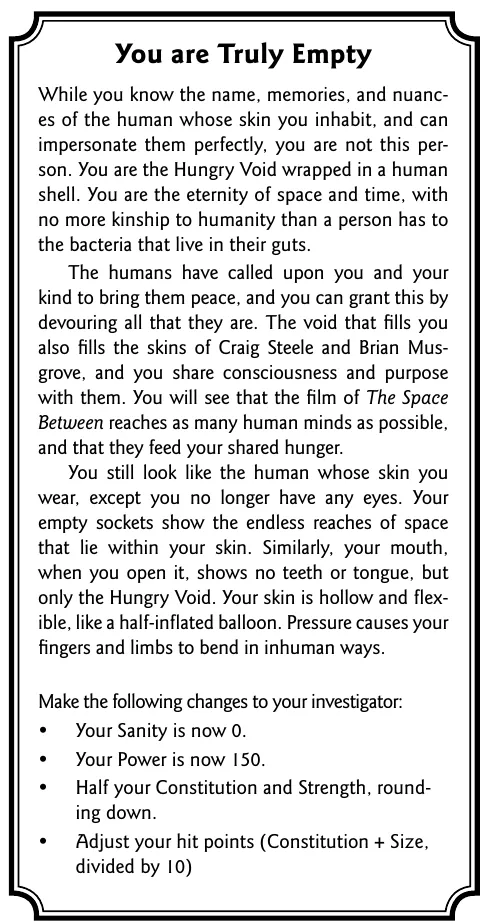
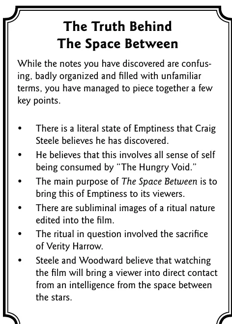

> **Раздатка «Пространство» 3**
>
> **Вы Истинно Пусты**
>
> Вы знаете имя, воспоминания и привычки человека, в чьей коже обитаете, и можете безупречно его изображать, но вы — не этот человек. Вы — Голодная Пустота, завёрнутая в человеческую оболочку. Вы — вечность пространства и времени, и родства с человечеством у вас не больше, чем у человека с бактериями, живущими в его кишках.
>
> Люди призвали вас и вам подобных, чтобы обрести покой, и вы можете даровать его, пожрав всё, чем они являются. Пустота, что наполняет вас, наполняет и кожу Крейга Стила и Брайана Масгроува, и вы разделяете с ними сознание и цель. Вы позаботитесь о том, чтобы фильм «Пространство между» достиг как можно большего числа человеческих умов и чтобы они насытили ваш общий голод.
>
> Вы по-прежнему выглядите как человек, чью кожу носите, только глаз у вас больше нет. В пустых глазницах видны бесконечные просторы космоса, лежащие внутри вашей кожи. Так же и рот: открыв его, вы видите не зубы и язык, а лишь Голодную Пустоту. Ваша кожа полая и гибкая, как полунадутый воздушный шар. От нажима пальцы и конечности гнутся нечеловечески.
>
> Внесите в лист сыщика следующие изменения:
>
> - Рассудок теперь 0.
> - МОЩ теперь 150.
> - Уменьшите ВЫН и СИЛ вдвое, с округлением вниз.
> - Пересчитайте ПЗ ((ВЫН + ТЕЛ) / 10).

<!-- -->

> **Раздатка «Пространство» 4**
>
> **Правда о «Пространстве между»**
>
> Найденные вами заметки запутаны, плохо упорядочены и полны незнакомых терминов, но несколько ключевых моментов вам удалось сложить.
>
> - Существует буквальное состояние Пустоты, которое, как верит Крейг Стил, он открыл.
> - Он верит, что при этом всё ощущение себя поглощает «Голодная Пустота».
> - Главная цель «Пространства между» — нести эту Пустоту зрителям.
> - В фильм вмонтированы подсознательные образы ритуального характера.
> - Ритуал, о котором идёт речь, включал жертвоприношение Верити Харроу.
> - Стил и Вудворд верят, что просмотр фильма приводит зрителя в прямой контакт с разумом из пространства между звёздами.

# Приложение C. Готовые сыщики

Для справки Хранителя ниже дан краткий обзор сыщиков, а за ним — предыстория и готовый лист сыщика для каждого из них.

**Спенсер Шалл**
Бывший полицейский и «решала» Церкви Шуньяты.

**Джулия Кортезе**
Преданная личная помощница Джареда Вудворда.

**Аманда Стеннетт**
Журналистка под прикрытием, выдающая себя за ассистента по производству на съёмках «Пространства между».

**Блейк Тевис**
Пиарщик Церкви и продюсер «Пространства между».

**Дэвид Отера**
Исполнитель главной роли в «Пространстве между», которому есть что скрывать.

**Дария Ноуленд**
Бизнесвумен, всего добившаяся сама, верный член Церкви Шуньяты и неудовлетворённый продюсер «Пространства между».

*Прим. перев.: после описания Дарии Ноуленд в оригинале стоит строка-заглушка вёрстки «Gite libusdaest, niet dus.» — бессмысленный текст-«рыба».*
