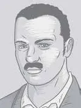

## Спенсер Шалл, 41 год, «решала» Церкви



```stat
СИЛ 55    ВЫН 50    ТЕЛ 75    ЛВК 65    ИНТ 85
НАР 45    МОЩ 65    ОБР 70    Рассудок 65   ПЗ 13
БкУ: +1d4   Комплекция: 1   Скорость: 7   Удача: 35
ПМ: 13

Ближний бой (драка)          55% (27/11), урон 1d3 + 1d4
Автоматический пистолет .45  20% (10/4), урон 1d10 + 2
Уклонение                    42% (21/8)

Навыки: Искусство/ремесло (фотография) 25%, Средства 30%, Вождение автомобиля 30%, Красноречие 65%, Запугивание 70%, Юриспруденция 45%, Работа в библиотеке 55%, Взлом 51%, Психология 50%, Внимание 55%, Скрытность 50%.
```

**Биография**

- **Описание:** поджарый, угловатый мужчина средних лет с хищным взглядом.
- **Идеалы и принципы:** можно делать всё, что нужно, как бы гнусно это ни было, — лишь бы потом тебя Опустошили от Горестей.
- **Значимые люди:** Брайан Масгроув, который дал тебе цель, когда всё казалось потерянным.
- **Важное место:** твой кабинет в штаб-квартире Церкви, где ты хранишь досье на врагов, друзей и членов Церкви.
- **Ценное имущество:** старинная фляжка, принадлежавшая твоему дяде Элу, тоже детективу отдела убийств. Ты держишь её полной хорошего бурбона.
- **Черта:** резок до грубости.

Ты работаешь на Церковь Шуньяты с тех пор, как тебя выжили из полиции Лос-Анджелеса. Ты уже тогда состоял в Церкви, но старался держать веру и личную жизнь отдельно — что бы там ни говорило служебное расследование. Сначала ты собирался стать частным детективом, но Брайан Масгроув, глава Церкви, пригласил тебя выпить и намекнул, что человек с твоими навыками будет ценным приобретением для организации.

С тех пор ты делаешь так, чтобы проблемы исчезали. Иногда достаточно убедить журналиста отказаться от смачной истории. Время от времени приходится прятать улики — налоговые документы, компрометирующие снимки или тело проститутки. Желудок у тебя стал крепким. Вера помогает.

Ходят слухи, что Церковь причастна к недавнему исчезновению Верити Харроу. Будь это правдой, именно ты сделал бы так, чтобы она исчезла, — а ты ничего не знаешь. Тебе не нравится ничего не знать, поэтому ты начал копать сам. Странно, что никто тебя об этом не попросил.

**Заметки игрока:** ____________________
