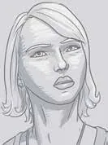

## Джулия Кортезе, 26 лет, преданная личная помощница



```stat
СИЛ 40    ВЫН 60    ТЕЛ 65    ЛВК 55    ИНТ 70
НАР 70    МОЩ 25    ОБР 70    Рассудок 25   ПЗ 12
БкУ: 0   Комплекция: 0   Скорость: 7   Удача: 60
ПМ: 5

Ближний бой (драка)   35% (17/7), урон 1d3
Уклонение             27% (13/5)

Навыки: Бухгалтерское дело 45%, Обаяние 55%, Средства 30%, Вождение автомобиля 60%, Первая помощь 65%, Иностранный язык (испанский) 51%, Работа в библиотеке 70%, Слух 65%, Внимание 65%, Метание 50%.
```

**Биография**

- **Описание:** молодая женщина с чуть страдальческим видом и большими выразительными глазами. Всегда хорошо одета.
- **Идеалы и принципы:** стать Пустой — самая важная цель в жизни.
- **Значимые люди:** Джаред Вудворд, которого ты тайно любишь.
- **Важное место:** квартира Джареда, где вы провели вместе ту чудесную ночь.
- **Ценное имущество:** жетон за два года без наркотиков.
- **Черта:** болезненная аккуратистка. Тебе всегда нужно убедиться, что всё как следует разложено по местам.
- **Имущество:** ключ от пентхауса Джареда.

Джаред Вудворд — кинорежиссёр и гений. Ты уже три года работаешь его помощницей, и это он привёл тебя в Церковь Шуньяты, сказав, что она поможет тебе найти свой путь, как помогла ему найти его. Ваши рабочие отношения стали ближе, и даже ходят слухи, что вы любовники. Ты действительно переспала с ним однажды, после пьяной вечеринки в начале этого года, но вы оба достаточно просветлены, чтобы из-за этого не стало неловко. Ну, Джаред, может быть, и просветлён. Тебе хочется знать, почему это ни к чему не привело, но, устроив сцену, ты рискуешь работой и положением в Церкви.

Церковь — твоя жизнь. Ты пока на нижних уровнях, но уже так многому научилась. Ты больше двух лет не употребляла кокаин. Ты надеешься однажды стать истинно Пустой.

В последнее время Джаред скрытен и замкнут. Раньше он делился с тобой всем о своей работе, а теперь ты только носишь ему еду и обновляешь его «Твиттер». Может, ему всё-таки неловко из-за того, что он с тобой переспал, а может, он просто одержим фильмом. Он говорит, что «Пространство между» покажет миру истину, лежащую в сердце Церкви, и работает днём и ночью, чтобы довести дело до конца. Может, когда фильм будет закончен, у него найдётся больше времени для тебя.

**Заметки игрока:** ____________________
