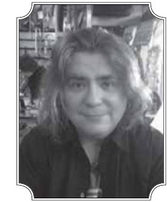
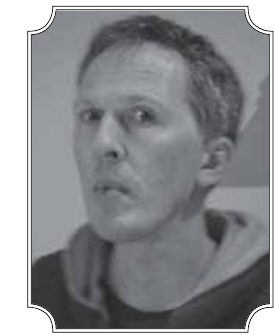

# Об авторах

### Скотт Дорвард

Скотт Дорвард — внештатный автор и редактор; он работал над рядом ролевых игр, в названии которых есть слово «Ктулху», и над несколькими, где его нет. В частности, Скотт ведёт линейку World War Cthulhu издательства Cubicle 7. Вместе с Полом Фрикером и Мэтью Сандерсоном Скотт ведёт «The Good Friends of Jackson Elias» — подкаст о «Зове Ктулху» и других ролевых играх ужасов.

Скотт живёт в Милтон-Кинсе — и уверяет, что это куда более приятное место, чем вам могли рассказывать.

### Пол Фрикер

Пол вырос в Бакингеме (Англия), где и живёт теперь с женой, кошкой и двумя детьми. Отучившись в художественной школе в мрачные 1980-е, Пол занялся преподаванием и гончарным делом. Регулярные поездки на игровые конвенты привели к тому, что он стал писать сценарии для публикации, а затем — соавтором седьмой редакции ролевой игры «Зов Ктулху». Пол — один из ведущих подкаста «The Good Friends of Jackson Elias», где он рассуждает об играх ужасов и смежных темах. Вечера он проводит за виниловыми пластинками и домашним сидром, тоскуя по золотой эпохе 1970-х.

### Мэтью Сандерсон

Мэтью мечтал стать писателем задолго до того, как услышал о ролевых играх. Страстный читатель ужасов и триллеров, он узнал о ролевых играх за две недели до школьных выпускных экзаменов — и с тех пор не оглядывался назад. Он регулярно бывает на британских игровых конвентах; однажды на местном мероприятии его заметили, когда он вёл игру по «Зову Ктулху», и это привело к публикации его первого сценария. С тех пор Мэтью писал для нескольких линеек ролевых игр, но больше всего — для тех, что посвящены козням Великих Древних.
