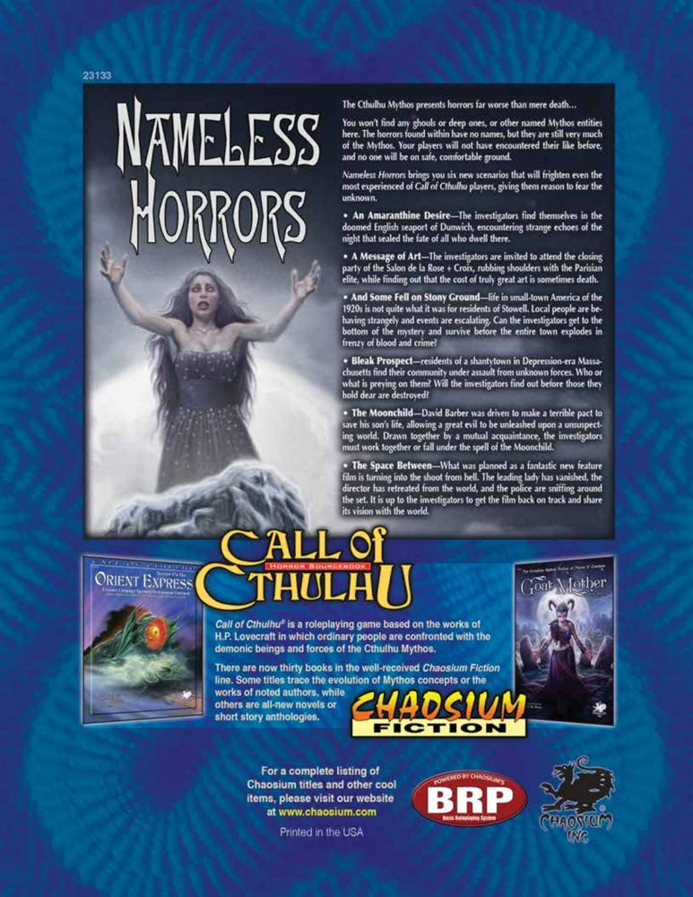

# Задняя обложка

**Безымянные ужасы**

Мифы Ктулху несут ужасы куда страшнее простой смерти…

Здесь вы не найдёте ни упырей, ни глубоководных, ни других сущностей Мифов, у которых есть имена. У ужасов этой книги нет имён, но они всё равно плоть от плоти Мифов. Ваши игроки никогда не встречали ничего подобного, и никто не будет стоять на безопасной, надёжной почве.

«Безымянные ужасы» — шесть новых сценариев, которые напугают даже самых опытных игроков в «Зов Ктулху» и дадут им повод бояться неведомого.

- **Неувядающее желание.** Сыщики оказываются в обречённом английском портовом городе Данвиче и сталкиваются со странными отголосками ночи, решившей судьбу всех его жителей.
- **Послание искусства.** Сыщиков приглашают на прощальный вечер Салона Розы и Креста, где они вращаются среди парижской элиты и узнают, что подлинно великое искусство порой обходится ценой жизни.
- **Иное упало на каменистое место.** Жизнь в маленьком американском городке 1920-х годов для жителей Стоуэлла уже не та, что прежде. Местные ведут себя странно, и события нарастают. Смогут ли сыщики докопаться до сути тайны и выжить, прежде чем весь город взорвётся безумием крови и преступлений?
- **Мрачные перспективы.** Жители трущобного лагеря в Массачусетсе времён Великой депрессии обнаруживают, что на их общину напали неведомые силы. Кто или что охотится на них? Узнают ли сыщики правду, прежде чем погибнут те, кто им дорог?
- **Лунное дитя.** Дэвид Барбер был вынужден заключить страшную сделку, чтобы спасти жизнь сына, и выпустил великое зло в ничего не подозревающий мир. Сведённые вместе общим знакомым, сыщики должны действовать сообща — или попасть под чары Лунного дитяти.
- **Пространство между.** То, что задумывалось как фантастический новый художественный фильм, превращается в съёмки из ада. Исполнительница главной роли пропала, режиссёр удалился от мира, а вокруг площадки рыщет полиция. Сыщикам предстоит вернуть фильм в колею и поделиться его видением с миром.

*«Зов Ктулху» — ролевая игра по произведениям Г. Ф. Лавкрафта, в которой обычные люди сталкиваются с демоническими существами и силами Мифов Ктулху.*

*В хорошо принятой серии Chaosium Fiction уже тридцать книг. Одни прослеживают развитие идей Мифов или творчество известных авторов, другие — совершенно новые романы и сборники рассказов.* (На обложке — книга серии «Goat Mother» и логотипы «Call of Cthulhu — Sourcebook», Chaosium Fiction, BRP.)

*Полный список изданий Chaosium и другие интересные вещи — на нашем сайте www.chaosium.com. Напечатано в США.*
