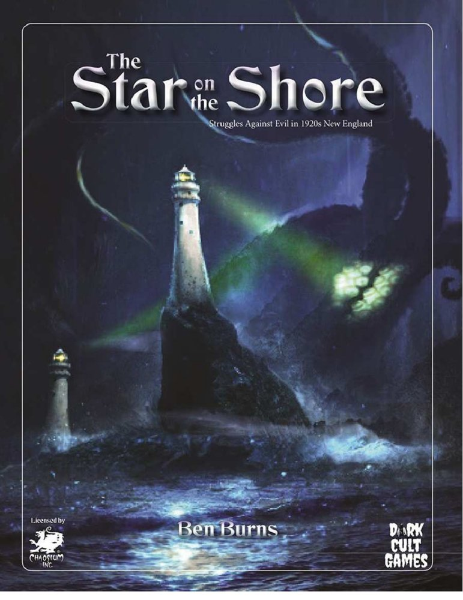

ЗВЕЗДА НА БЕРЕГУ

Борьба со злом в Новой Англии 1920-х годов

Бен Бёрнс

*На обложке — маяк на скале среди штормовых волн, второй маяк вдали, зелёные лучи прожекторов и огромные щупальца в ночном небе; вверху — название «The Star on the Shore» и подзаголовок «Struggles Against Evil in 1920s New England», внизу — имя автора (Ben Burns), знак «Licensed by Chaosium Inc.» и логотип Dark Cult Games.*
