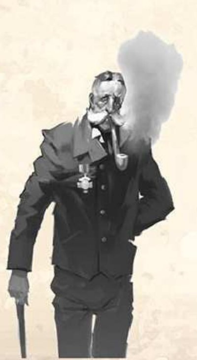

# Введение

«Звезда на берегу» — приключение для седьмой редакции «Зова Ктулху», рассчитанное на группу из четырёх–десяти сыщиков. Прежде чем вести приключение, Хранителю следует прочитать эту книгу сценария целиком.

Все раздатки для игроков помечены как раздатки, и Хранитель может свободно копировать их, чтобы вести это приключение. Хранитель выдаёт их сыщикам, когда об этом сказано в тексте модуля. Хотя многие места и события, описанные в этом приключении, реальны, все персонажи и имена в этой книжке вымышлены, и любое сходство с реальными людьми, живыми или умершими, совершенно случайно.

17 августа 1921 года, Бостон, штат Массачусетс. Доктор Тимоти Дженнингс из Музея изящных искусств нанял команду лучших сыщиков, чтобы найти украденную статую.

Дальше читает только Хранитель.

# Пролог

Гранит холодил босые ступни. Тёмно-синяя ряса, несмотря на холод, казалась тяжёлой и душной. Крошечные трещины и узоры в камне царапали кожу, когда он переминался с ноги на ногу в надежде, что толпа за спиной не заметит его волнения. Он оглянулся на них, но они были заняты делом: головы склонены, руки сложены под рясами, их пение — низкий гул, который отдавался эхом и разливался по пещере. Они ещё только распевались, но, прислушавшись, он услышал, как голоса медленно сливаются в единую песнь.

Жалко и нестройно вплетались в пение стоны девушки. Привязанная к большой статуе, стоявшей в одном конце пещеры, она уже не молила о помощи и пощаде — бесполезные мольбы сменились жалким хныканьем. Она понятия не имела, какая честь ей оказана, какое величие она принесёт в мир. Этот миг готовили десятилетиями, и она была лишь последней из тех, кто принёс великую жертву ради общего дела. Руки статуи изгибались к ней, словно желая её обнять, и он почти пожалел, что не может занять её место. Почти.

Пение достигло высшей точки, и он взглянул на карманные часы. Осталась всего минута. Он смахнул пот со лба и посмотрел на ходы, змеящиеся из этой пещеры во тьму. Он слышал эхо других голосов: их песнь вилась по пещерам и сливалась с остальными. Это обнадёживало, но ему нужно было знать, что всё готово, что всё безупречно.
