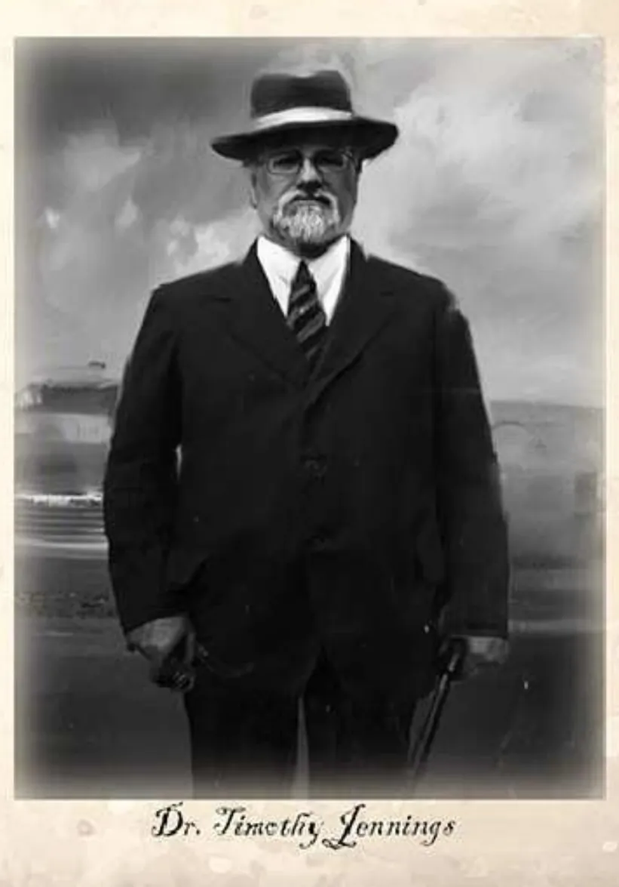

была нужна для обряда. Началась охота, и судьба была на их стороне.

Понадобилось бы восемь кругов призыва, расположенных особым образом. Джим и его последователи начали строить туннели, которые теперь лежат под городом. Культисты обнаружили, что по этим новым туннелям можно свободно перемещаться по всему городу.

Наконец, после десятилетий строительства, туннели были закончены. Но к тайнику статуи культисты не приблизились ни на шаг с того дня, как взялись за туннели. Джим умер, не завершив дела своей жизни. Он так и не увидел идола, о котором грезил столько ночей. Пророчество и судьбу он передал сыну, Сэму.

Когда система туннелей была готова, Сэм передал повседневные дела культа жене и маленькому сыну. Теперь Сэм знал, что статую спрятали далеко от Рокпорта, и отправился на её поиски. Он объехал весь мир, разгадывая подсказки и следуя своим снам и знамениям.

После многих лет поисков Сэм нашёл статую в гробнице на юге Перу. Её спрятали там много веков назад, запечатали и прокляли всякого, кто попытается её забрать. Отряд искателей сокровищ погиб, добывая её для Сэма. Вернуться в Штаты со статуей весом 136 кг было непросто, но весной 1912 года Сэм наконец сошёл на берег в Бостонской гавани. Но судьба коварна.

Сэму не терпелось похвастаться своим трофеем, а его друг, преподобный Майкл Томас, держал небольшую общину в месте под названием Часовня созерцания в Бостоне. Туда Сэм и отвёз статую, чтобы её показать.

Возможно, если бы он сразу поехал в Рокпорт, Сэм избежал бы проклятия. Но вместо того чтобы исполнить судьбу идола, Сэм потешил своё самолюбие. Так или иначе, именно в ту ночь полиция устроила облаву на Часовню созерцания. В ту роковую ночь Сэм Ран и статуя оказались в ловушке. Сэм погиб той ночью в пожаре: он отказался бросить статую, поглотившую его жизнь.

Весть о гибели отца терзала 21-летнего Габриэля Рана. Он винил во всём преподобного Томаса и поклялся ему отомстить. Габриэль устроил преподобному побег из тюрьмы и подбросил улики, указывавшие, будто тот бежал из штата. Преподобный с благодарностью принял предложенное Габриэлем надёжное убежище в Рокпорте. Он рассказал Габриэлю о визите его отца в ту злосчастную ночь и о статуе, которую тот привёз из Перу.

