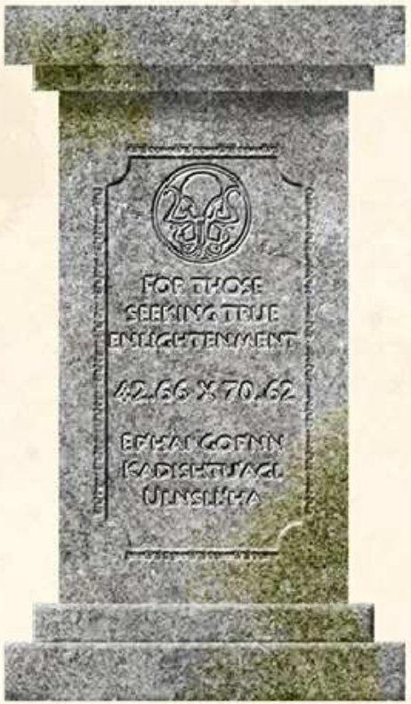

глубоководных, а теперь и звёздного отродья. Кроме того, если кто-то из горожан, не состоящих в культе, начнёт задавать вопросы о культе или бросит ему вызов, его тоже принесут в жертву.

Ещё Габриэль наложил на звёздное отродье успокаивающее заклинание, чтобы удержать его в яме, и убедил его довольствоваться ежедневными жертвами, которыми он его кормит. Если Габриэля убьют, оба заклинания развеются: разум художников в Бэрскин-Нек освободится, а звёздное отродье вырвется на волю. Художники придут в замешательство и захотят просто вернуться к прежней жизни, а звёздное отродье поднимется на поверхность кормиться.

Поначалу сыщиков нанимают вернуть украденную статую. По пути они столкнутся с культистами, глубоководными и, наконец, со звёздным отродьем. Эти встречи смертельно опасны, и если сыщики бросятся в них очертя голову, без подготовки, их легко могут убить. Это приключение-«песочница»: мы даём город, персонажей и предысторию, а как всё сложится — решают Хранитель и сыщики. Хранитель может свободно использовать культистов, чтобы задерживать сыщиков, мешать им или давать ложные сведения, — только отмечайте, кто из персонажей Хранителя уже убит, по списку культистов в справочном разделе в конце книги. Культисты дерзки, но не глупы. Большинство поначалу будут казаться дружелюбными и готовыми помочь, а сами — сообщать о подозрительных действиях в полицию, которая, в свою очередь, сообщит Габриэлю.

*На постаменте — знак с головой Ктулху и надпись: «ДЛЯ ИЩУЩИХ ИСТИННОГО ПРОСВЕТЛЕНИЯ · 42.66 X 70.62 · EP’HAI GOF’NN KADISHTU’AGL ULNSLL’HA».*

Габриэль может также пользоваться городскими воронами, чтобы шпионить за сыщиками или мешать им, но не чаще раза в день.

В городе и по ходу приключения есть несколько способов одолеть звёздное отродье. Подробнее о разных способах — в справочном разделе: он поможет Хранителю вести эти развязки. Но не считайте, что других способов одолеть звёздное отродье нет. Если сыщики придумают свой, особый способ его уничтожить, позвольте им. Но стоять перед ним с пистолетами не должно сработать никогда.

# Дело

Сыщики встречаются с доктором Дженнингсом у часовни. Это пожилой джентльмен с начинающими седеть волосами, в сером костюме. Его небольшие бородка и усы слегка побурели от трубки, которую он курит постоянно. Держится он уверенно и говорит строгим голосом профессора.

Пустырь, где когда-то стояла часовня, почти весь зарос травой и бурьяном, в глубине участка растут деревья. Один участок расчищен, и большая часть обломков старой часовни свалена в сторону. Сыщики видят провал, ведущий в бывший подвал. Подвал раскопан, и в нём обнаружен передний зал. В подвал спускаются лестницы.
