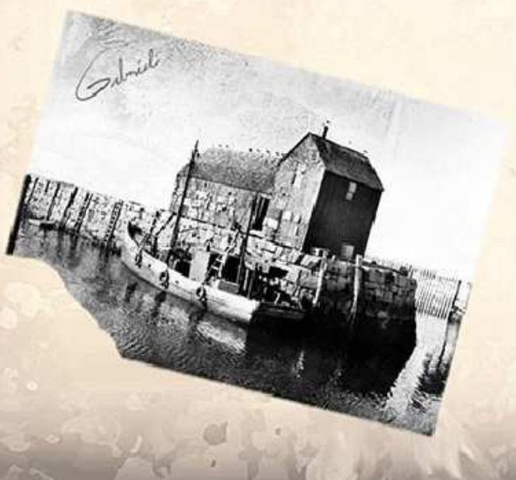

От находки остался только гранитный постамент высотой около 90 см и чуть больше 30 см в сечении, со стёртым местом посередине. На граните вырезано:

> *Для ищущих истинного просветления*
>
> *42.66 x 70.62*
>
> *Ep’hai Gof’nn Kadishtu’agl Ulnsll’ha*

**Выдайте игрокам раздатку 1.**

Сыщик, прошедший проверку навыка Наука (геология), может сказать, что гранит — из каменоломен Рокпорта.

Сыщик, прошедший проверку навыка Ориентирование, узнает в числах координаты GPS Рокпорта, штат Массачусетс.

*Прим. перев.: так в оригинале — «GPS coordinates»; в 1921 году GPS ещё не было, по смыслу это просто географические координаты (широта и долгота).*

Проверка Внимания позволит найти наполовину обгоревшую, частью засыпанную землёй открытку. На ней — сарай на краю причала. Открытка не очень старая. Покажите сыщикам раздатку 2. На открытке написано имя «Gabriel» (Габриэль). Остальной текст утрачен.

Сыщик, прошедший проверку навыка Искусство/ремесло (фотография) или Искусство, узнает в постройке «Мотив № 1» — знаменитый красный сарай на пристани Брэдли в Рокпорте, штат Массачусетс.

У доктора Дженнингса есть рисунок статуи. Выдайте сыщикам раздатку 3. Статуя 30 см в ширину, 30 см в глубину и 60 см в высоту, из цельного гранита, весит около 136 кг.

Любая из этих улик должна привести сыщиков в Рокпорт. Если никто не догадается, сыщикам стоит понять, что это координаты, и с помощью библиотеки или того же музея найти карту и Рокпорт на ней. Если они не могут разгадать координаты, разрешите всем проверки Идеи, пока кто-нибудь не пройдёт её, и тогда скажите им, что числа — это координаты.

Когда сыщики выходят из подвала, проверка Внимания позволит кому-нибудь заметить, что над головой кружит необычно много ворон.

Доктор Дженнингс расскажет, что статую украли 12 дней назад. Кража 136-килограммовой статуи была странной, но о худшем он не думал до вчерашнего дня, когда получил копию телеграммы некоего У. У. Кэмпбелла, отправленной в Гарвардскую обсерваторию 8 августа. Он покажет телеграмму сыщикам. Выдайте сыщикам раздатку 4. В ней говорится:

**Заголовок:** Наблюдения неопознанного объекта вблизи Солнца в воскресенье, 7 августа 1921 года
**Автор:** Кэмпбелл, У. У.
Телеграмма, полученная Гарвардской обсерваторией:
