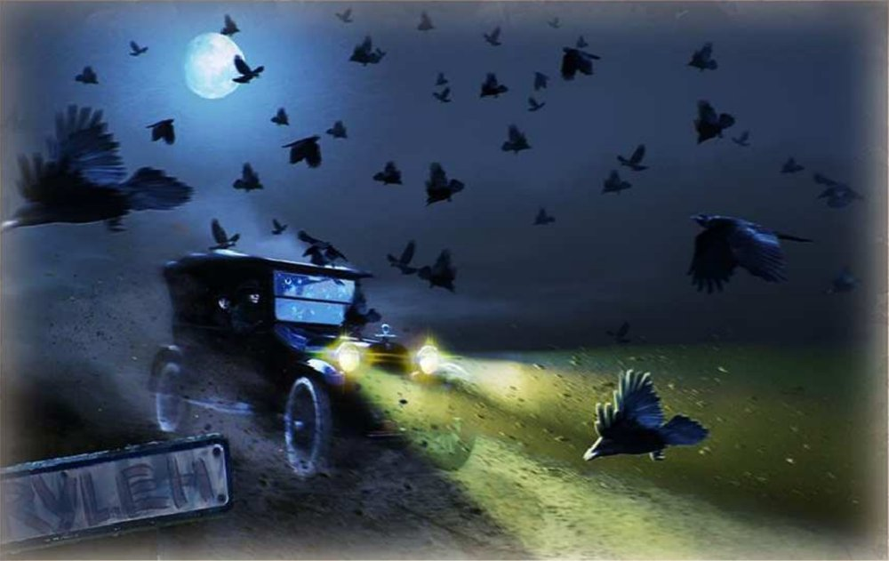

> *«Звездообразный объект, определённо ярче Венеры, в трёх градусах к востоку и одном градусе к югу от Солнца наблюдался невооружённым глазом за несколько минут до заката и на закате. Пять наблюдателей. Зашёл за низкие облака. Несомненно небесный объект. Вероятнее всего, ядро яркой кометы, менее вероятно — новая звезда»¹.*
>
> *«Дальнейшие расчёты показывают, что падающий объект упал в районе побережья Новой Англии».*

**Выдайте игрокам раздатку 4.**

*¹ Сноска оригинала: источник цитаты указан в «Справочных заметках» (с. 94).*

Доктор Дженнингс в разумных пределах оплатит сыщикам всё, что им, по их мнению, понадобится. Он посоветует мужчинам взять огнестрельное оружие, а любой женщине выдаст оружие, если она попросит. Ещё он предложит сыщикам по 20 долларов в день на каждого за возвращение статуи и разрешение всего, что последовало за её кражей. Проверка Психологии подскажет, что он чего-то недоговаривает. Если надавить на него, он упомянет убитого сторожа. Если после этого потребовать больше денег, он поднимет плату до 25 долларов в день на каждого сыщика. Он снял для сыщиков комнаты в Доме Вудса в Рокпорте (место 5, см. ниже).

Он опасается, что кража статуи и астрономическое явление так близко по времени — едва ли совпадение.

# Дорога в Рокпорт

Добраться до Рокпорта сыщики могут парой способов. Они могут поехать поездом. Проще

> **C’ai yorr’enyth**
> **nnn’nilgh’ri**
>
> *(«Мы говорим нашему духу-слуге следить за всем» — перевод из «Справочных заметок», с. 94.)*
