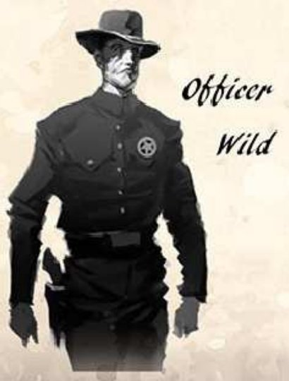

и безопаснее, но в Рокпорте они окажутся без машины. По Рокпорту ходят трамваи, но всё же было бы проще, будь у них хотя бы одна машина.

<u>Поезд.</u> Если сыщики выберут поезд, они доберутся без происшествий и прибудут на станцию ближе к вечеру, к ужину. См. место 4.

<u>Машина.</u> Если сыщики поедут на машине, въезжать в город придётся по Мейн-стрит. Есть дорога, которая идёт вдоль побережья и подходит к городу с юга, но сейчас её размыло, и на машине там не проехать. Есть и дорога, спускающаяся с севера, но она пока не достроена и непроходима.

Дорога из Бостона проходит спокойно, пока сыщики не минуют Глостер. Небо сильно темнеет, хотя на дворе всего лишь середина дня, а шоссе превращается в грунтовку. Если сыщик попробует определить направление, проверка Ориентирования покажет, что они едут на запад, а не на север или восток. Если воспользоваться компасом, стрелка будет метаться и так и не успокоится.

Если сыщики продолжат путь, на машины налетит стая ворон, и водителю каждой машины понадобится проверка навыка Вождение автомобиля. Если водитель прошёл проверку, он может выбрать: остановить машину или дать газу, чтобы оторваться от ворон. При провале машина слетает в кювет. Каждый в машине должен пройти проверку Удачи или получить 1d4 урона. Разбитая машина будет повреждена, и прежде чем на ней снова можно будет ехать, потребуется проверка навыка Механика.

Вороны несколько минут кружат над остановившейся или разбитой машиной, а потом бьются в окна, так что стёкла трескаются, каркают и всячески угрожают. Каждый должен пройти проверку Рассудка (0/1d3), после чего вороны улетают.

Если водитель решит не останавливаться, а оторваться от ворон, ему нужна вторая проверка Вождения автомобиля, иначе машина въедет в пруд, которым заканчивается дорога. Пруд неглубокий, но машину будет не спасти. Если вторая проверка пройдена, машина останавливается у самого пруда.

Когда вороны улетают, снова становится светло, и сыщики могут вернуться на Мейн-стрит и въехать в город.

# Город Рокпорт

На первый взгляд Рокпорт — обычный маленький прибрежный городок северо-востока. В XIX веке город разросся благодаря каменоломням, но потом начал хиреть, и теперь в нём живёт чуть меньше 1000 человек. Поэтому в Рокпорте много пустых и заброшенных зданий.

Большинство жителей знают о культе, но отказываются о нём говорить: те, кто говорит, обычно погибают или пропадают без вести. Кто-то может решить, что сыщики сами из культа или работают на него. В городе есть несколько персонажей Хранителя,
