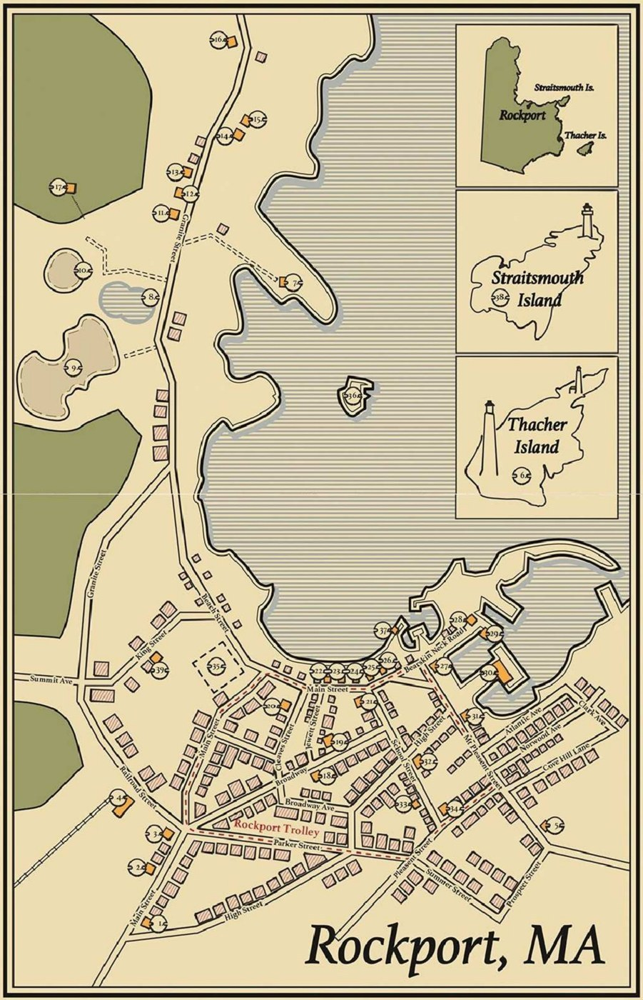

# Карта Хранителя

*Карта занимает разворот (с. 14–15) и напечатана повёрнутой; здесь обе половины склеены. Надписи карты: «Rockport, MA» — Рокпорт, штат Массачусетс; врезки «Rockport» (Рокпорт, с островами Straitsmouth Is. — Стрейтсмут и Thacher Is. — Тэтчер), «Straitsmouth Island» — остров Стрейтсмут (место 38), «Thacher Island» — остров Тэтчер (место 6); «Rockport Trolley» (красный пунктир) — маршрут рокпортского трамвая. Улицы: Main Street, Granite Street, Beach Street, King Street, Summit Ave, Railroad Street, Broadway, Broadway Ave, Cleaves Street, Jewett Street, School Street, High Street, Mt Pleasent Street, Pleasent Street, Parker Street, Summer Street, Prospect Street, Atlantic Ave, Norwood Ave, Clark Ave, Cove Hill Lane, Bearskin Neck Road.*

**Ключ карты (номера мест)**

| № | Место | № | Место |
|---|---|---|---|
| 1 | Полицейский участок Рокпорта | 21 | Церковь Олд-Слуп (конгрегационалистская церковь) |
| 2 | Мясная лавка «Гриффон» | 22 | Магазин Джона Тарра |
| 3 | Скобяная лавка Смита | 23 | Мемориальный зал Рокпорта |
| 4 | Железнодорожная станция | 24 | Библиотека Рокпорта |
| 5 | Дом Вудса | 25 | Кафе «Сэнди-Бэй» |
| 6 | Маяки острова Тэтчер | 26 | Художественная ассоциация Рокпорта |
| 7 | Гранитная компания Рокпорта | 27 | Бэрскин-Нек |
| 8 | Карьер № 1 | 28 | «Суда и рыбалка братьев Брэдли» |
| 9 | Карьер № 2 | 29 | Красный сарай («Мотив № 1») |
| 10 | Карьер № 3 | 30 | Межштатная рыбная корпорация |
| 11 | Аптека «Гранит» | 31 | Пекарня «Сэнди-Бэй» |
| 12 | Контора Дэвида Бэбсона | 32 | Театр Рокпорта |
| 13 | Парикмахерская Бейли | 33 | Обивочная мастерская Така |
| 14 | Часовня Пиджен-Коув | 34 | Школьная улица, 224 — дом Нэша Филбертона |
| 15 | Инструментальная компания Кейп-Энн | 35 | Кладбище Пэрриш |
| 16 | Дом ведьмы | 36 | Остров Сэнди-Бэй-Рок |
| 17 | Дом старика Дугласа | 37 | Рыбацкая пристань |
| 18 | Почта и телеграф | 38 | Остров Стрейтсмут |
| 19 | Ратуша | 39 | Редакция «Рокпорт рипорт» |
| 20 | Церковь универсалистов | | |

*Ключ составлен переводчиком по заголовкам мест 1–39 в тексте книги: на самой карте стоят только номера.*
