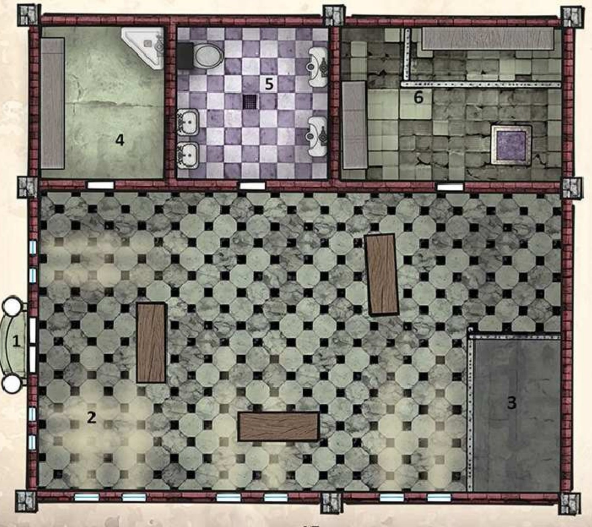

<u>Начальник полиции Кори Стаддард.</u> Кори уже 9 лет возглавляет полицию Рокпорта. Ему 40 лет, рост 183 см, у него седые волосы и среднее телосложение. Он дружелюбен и общителен, но нападёт, если сыщики нападут на культ. Его часто можно встретить разъезжающим по городу на машине или в кафе «Сэнди-Бэй».

```stat
Начальник полиции Кори Стаддард
СИЛ 75  ВЫН 65  ТЕЛ 60  ИНТ 80  МОЩ 65  ЛВК 75
НАР 65  Рассудок 55  ОБР 70  ПЗ 12  Скорость: 9  Комплекция: 1
БкУ: +1d4        Уклонение 50%
Бой: Драка 40% (20/8), урон 1d3 + БкУ
Пистолет 50% (25/10) (револьвер .45), урон 1d10+2
Винтовка 60% (30/12) (.30-06 со скользящим затвором), урон 2d6+4
Навыки: Психология 60%; Убеждение 50%; Юриспруденция 50%.
```

*Прим. перев.: в оригинале у винтовки «60% (30/6)»; пятая доля исправлена на 12 по правилам седьмой редакции.*

**Полицейский участок**

1. Входная дверь.
2. Главный зал участка со столами, телефонами и рапортами.
3. Камера: сейчас в ней никого нет.
4. Кладовка: в этой маленькой комнате — уборочный инвентарь, полицейские бланки, старые дела и канцелярские принадлежности.
5. Уборная.
6. Оружейная: под замком — дробовики, винтовки, пистолеты, патроны, наручники и полицейские дубинки. Здесь же люк, ведущий в T1.


