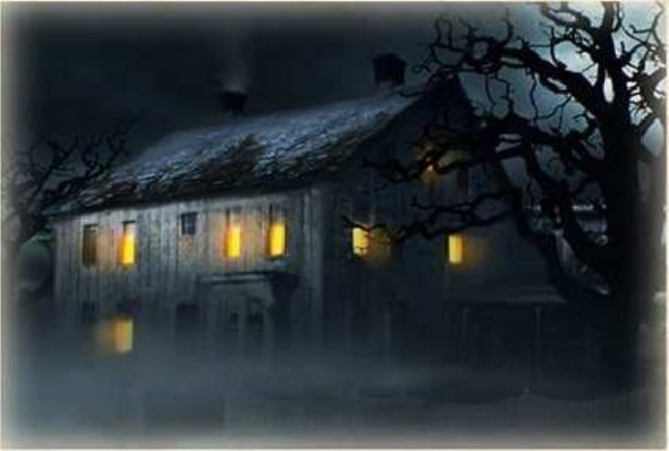

> *«В центре города, хорошо обставлен, все современные удобства; рядом пляж, лодки, рыбалка и трамвай. Домашняя кухня».*

Дом назван в честь знаменитого адвоката Анри Вудса, защищавшего Альберта Джоя — человека, обвинённого в убийстве своего товарища, коммивояжёра Чарльза Гилмана. Чарльза убили у каменоломни. Никто так и не узнал, что он был одной из первых жертв культа Ктулху в 1877 году. Официальная версия:

> *«Это было 11 апреля 1877 года — рокпортское дело об убийстве с участием двух коммивояжёров. Двое мужчин, Альберт Джой и Чарльз Х. Гилман, приехали в Рокпорт девятичасовым утренним поездом из Беверли. Пока Гилман обходил дома, предлагая приставку к швейным машинкам, Джой слонялся у железнодорожной станции. Около полудня обоих видели проходящими через станцию и выходящими из её западного конца в сторону ближней каменоломни. Через полчаса Джоя видели возвращающимся — одного. Он прошёл по Пулс-лейн до Мейн-стрит, потом на Бродвей и в город, где зашёл в ресторан и заказал рагу из устриц и чай. Затем он вернулся на станцию и сел в поезд, который должен был отойти в 13:30. Пока он ждал отправления, вдруг раздались крики: „В водохранилище нашли мертвеца!“ Услышав это, Джой воскликнул: „Боже мой! Это мой приятель“.*
>
> *Полиция быстро арестовала Джоя; он твердил о своей невиновности и говорил, что оставил Гилмана у водохранилища, а сам пошёл за едой. Защищал его Анри Вудс; суд над Джоем за убийство Гилмана начался в Сейлеме 9 июля 1877 года. После четырёхдневного процесса присяжные признали его виновным. Его приговорили к повешению, но за четыре дня до назначенной казни губернатор отсрочил приговор. Через несколько недель губернатор заменил ему казнь пожизненным заключением»².*

*² Сноска оригинала: источник указан в «Справочных заметках» (с. 94).*

В Доме Вудса три этажа и подвал. Он вмещает до 10 гостей и по желанию предлагает домашнюю еду. Комнаты прислуги — за домом. Сейчас там живёт только Филлис. На одном из деревьев, разбросанных по большому заднему двору, тихонько покачиваются качели из покрышки. Сам дом обставлен в старомодном викторианском стиле.

Диваны и кресла в гостиной удобные, плюшевые. Выделяется коричневая ткань с золотой вышивкой. Почти весь пол гостиной покрывает красный персидский ковёр.

Оттуда деревянная лестница ведёт наверх, в столовую. За обеденный стол садятся 10 человек, а резьба на нём повторяет узор дивана. Стулья целиком деревянные, только на сиденьях — плюшевые коричневые подушки. Столовую наполняет запах стряпни с кухни, где Филлис всегда что-нибудь готовит.

По всему дому развешаны картины. Как минимум одна картина с Красным сараем («Мотивом № 1») есть в
