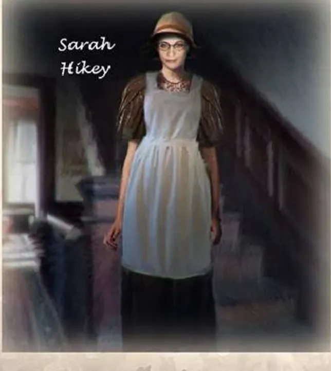

гостиной, а ещё несколько картин — из Художественной ассоциации. Все картины — портреты или виды моря и маяков.

Спальни все похожи: в каждой кровать в викторианском стиле, деревянный стул, платяной шкаф и небольшой письменный стол.

<u>Сара Хайки.</u> Саре 21 год, у неё светлая кожа и длинные каштановые волосы. Глаза очень тёмные и чуть великоваты для её маленького носа. Рост 160 см, она очень худая. Деловая хватка у неё отличная, но во всём, что не касается её гостиницы, она довольно наивна и доверчива. Оба её родителя, державшие гостиницу до неё, умерли совсем недавно при странных обстоятельствах. Отец умер 2 года назад, мать — 9 месяцев назад. Ни о каком культе она не знает и в магию не верит. Вудс — девичья фамилия матери Сары; она правнучка Анри Вудса. Она обожает рассказывать историю об убийстве. Сара хорошо образованна и начитанна.

<u>Итан «Биг И» Денхэм.</u> Биг И — 12-летний мальчик. Он Саре не родственник. Когда приезжают новые гости, они с Томми приходят помогать за чаевые и 25 центов в день. Если сыщики попросят, он будет выполнять для них мелкие поручения. Он знает по именам всех персонажей Хранителя и знает, кто из них хороший, а кто нет. Ещё он знает о туннелях и о входе на кладбище. Иногда они с братом играют в туннелях, но к каменоломне не подходят. Томми любит всё разведывать, но Итан не пускает его слишком далеко: он очень опекает старшего брата. Семья Итана в трудном положении, поэтому Сара помогает мальчикам, когда может.

<u>Томми.</u> Томми — старший брат Итана, ему 13 лет, у него синдром Дауна. Он тихий и мало говорит, потому что его слова трудно разобрать. Он очень дружелюбен и старается помочь. Другие мальчишки в городе его задирают, поэтому Биг И и Томми держатся особняком. Толку от Томми будет немного, но он видел и глубоководных, и звёздное отродье. Иногда он тайком уходит ночью к океану. Он был там в ту ночь, когда культ призвал звёздное отродье. Ничего внятного сыщикам он рассказать не сможет, но может нарисовать и тех и другое и отвести сыщиков к заливу, где их видел. Если сыщики попросят его нарисовать, выдайте им раздатки 18 и 19, смотря по обстоятельствам.

<u>Филлис.</u> Филлис — 48-летняя чернокожая женщина, которая работает у Сары кухаркой и экономкой. Она родом с Кубы и много лет работала у матери Сары, помогая растить Сару. Она очень опекает и Сару, и обоих мальчиков. Она прекрасно знает, чем занимается культ, но ограждает от всего этого Сару и будет держать
