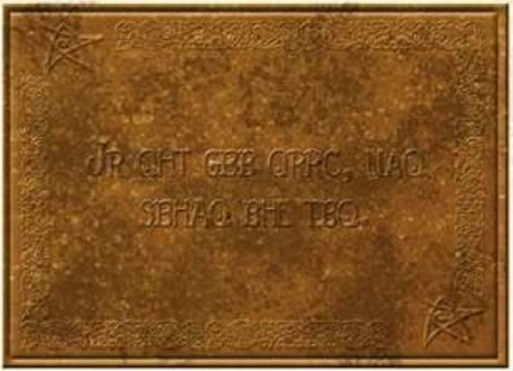

сыщиков от того, чтобы доказать это Саре или втянуть её или мальчиков в помощь. Она не даст сыщикам никаких сведений, которые могли бы подвергнуть Сару или мальчиков опасности.

# Место 6

## Маяки острова Тэтчер

У самого побережья лежит остров Тэтчер — маленький остров среди бурных, опасных вод. На южной и северной оконечностях острова стоят два одинаковых маяка. 148 ступеней ведут в вахтенное помещение, где смотрители проводят большую часть времени. Над ним — фонарное помещение.

Если сыщики попробуют совместить звёздную карту с картин и пройдут проверку Внимания с вершины маяков, они различат узор, который образуют здания города. Тогда они заметят, что на крыше каждого здания со входом в туннели лежит каменная плита.

Когда сыщики наймут лодку, чтобы добраться до маяков, начнётся событие «Шторм». См. раздел «События».

Между маяками стоит небольшой сарай для инструментов. Этот старый деревянный сарай насквозь прогнил и, похоже, давно не используется. Дверь закрыта на ржавую цепь с висячим замком. Замок открывается проверкой Взлома со штрафной костью. Но доски легко ломаются, так что в сарайчик может забраться кто угодно. Внутри — инструменты, в том числе лопаты и кирки, пол земляной. Всё затянуто паутиной, и от света разбегаются пауки.

Если сыщики начнут копать земляной пол, примерно на глубине 10 см они наткнутся на что-то. Оно твёрже земли, но мягче камня или металла. Это деревянная доска 30 на 45 см толщиной около 1,3 см. Для доски, пролежавшей в земле так долго, она на удивление хорошо сохранилась, и на ней легко прочесть выжженные слова:

> *«Когда мир перевернётся вверх дном»*

Под деревянной доской в землю вмурована бронзовая табличка. Если расчистить землю, видна гравировка: *«Jr qht gbb qrrc, naq sbhaq bhe tbq.»* Перевод: «Мы копали слишком глубоко и нашли нашего бога». Табличка вмурована в гранитную скалу под ней, и, чтобы её выкопать, понадобится час-два.

**Выдайте сыщикам раздатку 17.**

<u>Таннер Бивенс.</u> Таннер больше 20 лет служит смотрителем маяка. Этот 53-летний загорелый темноволосый мужчина живёт в маленьком доме на острове Тэтчер, на тропе между небольшой пристанью и южным маяком. Таннер человек грубоватый. Он ничего не знает ни о культе, ни о его делах. Он знает, что старый сарай для инструментов стоит там, но ключа от него у него нет, и внутри он никогда не бывал.

У него 6 помощников, которые следят, чтобы огни горели. Все они знают о культе, и их всегда можно встретить по двое.
