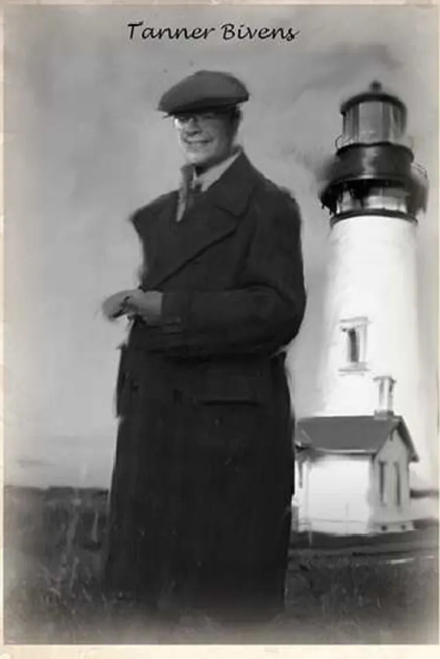

# Место 7

## Гранитная компания Рокпорта

Гранитная компания Рокпорта открылась в 1840 году и поставляла гранит без включений и трещин. Гранитные блоки компания вырубала динамитом, паровыми бурами и ручным инструментом. Компании принадлежат почти все гранитные карьеры Рокпорта. В 1880-х гранитное дело процветало, но последние 20 лет неуклонно хиреет. В компании всё ещё работают две-три сотни камнерезов, но в ближайшие 10 лет она объявит о банкротстве.

Днём большинство рабочих — в двух дальних карьерах. Время от времени сыщики будут слышать взрывы динамита или гул парового бура с карьеров. Если они попробуют поговорить с кем-нибудь из рабочих, то обнаружат, что большинство не говорит по-английски. Большинство говорит по-французски или по-итальянски. Если найдётся тот, с кем можно объясниться, успешная проверка Убеждения позволит узнать, что в главном карьере (карьер № 1) больше никто не работает и рабочие к нему не подходят. Слишком много людей оттуда пропало. После этого подойдёт мастер, потребует у сыщиков профсоюзные билеты и велит им убираться к чёрту с рабочего места.

Если сыщики пойдут за рабочим до дома, проверка Убеждения много нового не даст — только то, что в городе творится что-то странное. Могут рассказать историю о двух рабочих-камнерезах, братьях, которые пошли купаться в карьер № 1, и больше их никто не видел. Другие рабочие нашли их одежду у карьера. Полиция сказала, что они пошли купаться в океан и их унесло отбойным течением, но тела так и не нашли. Хозяева будут вежливы, но вскоре после прихода сыщиков настоят, чтобы те ушли.

Склад стоит в начале гранитного пирса Рокпорта. Вокруг склада разбросана дюжина поддонов с гранитом. У одной стены — запертая клетка с разными инструментами для добычи гранита, в том числе парой паровых буров и ручным инструментом. Там же, в клетке, — запертый шкаф для взрывчатки, в котором восемь шашек динамита. В остальном склад пуст. Есть контора с окном, выходящим на склад. В ней хранятся книги учёта отгрузок гранита. В конторе — люк, ведущий вниз, ко входу T7 в туннели. Дверь конторы заперта, если там нет Джастиса.
