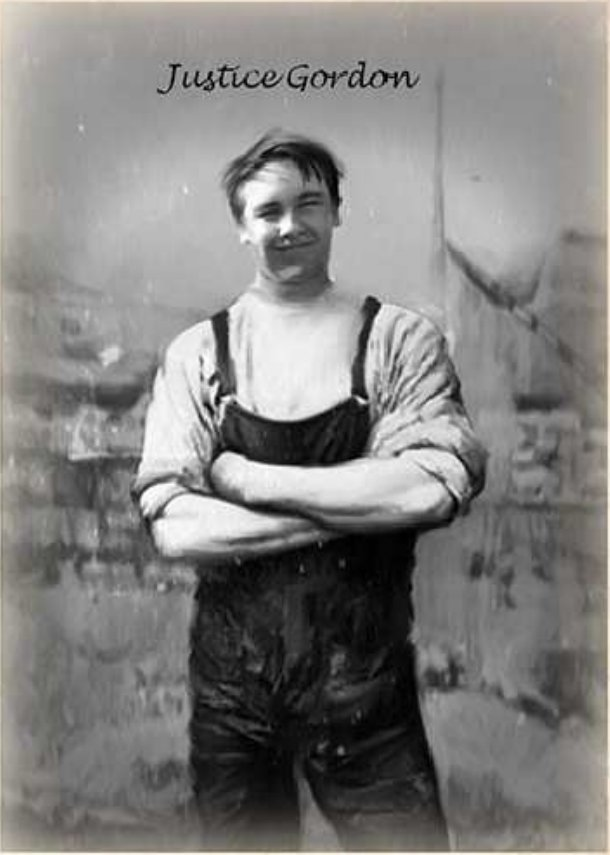

Днём на складе можно встретить других рабочих, похожих на карьерных. Их работа — укладывать гранит на поддоны и помогать грузить их на суда у пирса. Знают они не больше, чем рабочие карьеров.

<u>Джастис Гордан.</u> Джастис очень высокий — 198 см — и не стесняется пользоваться своими размерами, чтобы подавлять и запугивать людей. Своими ростом и силой он и добился нынешнего положения всего в 23 года. У него светлые волосы и серые глаза; он и умён, и жаден. Он знает о культе всё, в том числе о Габриэле, о преподобном и о звёздном отродье. Помыкать собой он не позволит, но его можно подкупить.

```stat
Джастис Гордан
СИЛ 80  ВЫН 65  ТЕЛ 85  ИНТ 70  МОЩ 45  ЛВК 50
НАР 75  Рассудок 25  ОБР 50  ПЗ 15  Скорость: 7  Комплекция: 2
БкУ: +1d6        Уклонение 30%
Бой: Драка 70% (35/14), урон 1d3 + БкУ
Меч 40% (20/8), урон 1d8+1 + БкУ
Навыки: Запугивание 45%; Взрывчатка 40%; Метание 30%;
Управление тяжёлыми машинами 30%; Обаяние 45%.
```

*Прим. перев.: так в оригинале — в тексте «Justice Gordan», в заголовке статблока и в подписи к портрету «Justice Gordon».*

<u>Райан Гримсли.</u> Рост Райана 175 см, он коренаст. Райан — ночной сторож и член культа. Он носит револьвер .38 и прогоняет всякого, кого застанет у карьеров или у Гранитной компании Рокпорта. Он знает всех главных членов культа и всё о туннелях и звёздном отродье.

```stat
Райан Гримсли
СИЛ 40  ВЫН 35  ТЕЛ 60  ИНТ 50  МОЩ 45  ЛВК 45
НАР 50  Рассудок 38  ОБР 50  ПЗ 9  Скорость: 7  Комплекция: 0
БкУ: нет        Уклонение 30%
Бой: Драка 30% (15/6), урон 1d3 + БкУ
Меч 35% (17/7), урон 1d8+1 + БкУ
Пистолет 40% (20/8), револьвер .38, урон 1d10
Навыки: Внимание 40%; Психология 40%.
```



# Место 8

## Карьер № 1

Карьер № 1 — большая яма в земле, откуда Гранитная компания Рокпорта добыла много гранита. Она примерно наполовину заполнена водой. Чуть ниже поверхности воды — вход в туннель, который ведёт вверх, в главный храм, T9. С поверхности отверстия не видно. Чтобы найти вход, нужно нырнуть.

Время от времени члены культа выходят из туннеля и плавают по карьеру. Если сыщики просто подойдут к карьеру, шанс увидеть это — всего 5%. Если они будут следить за карьером целые сутки, с шансом 50% они увидят людей, которые просто плавают по карьеру, а потом снова исчезают.
