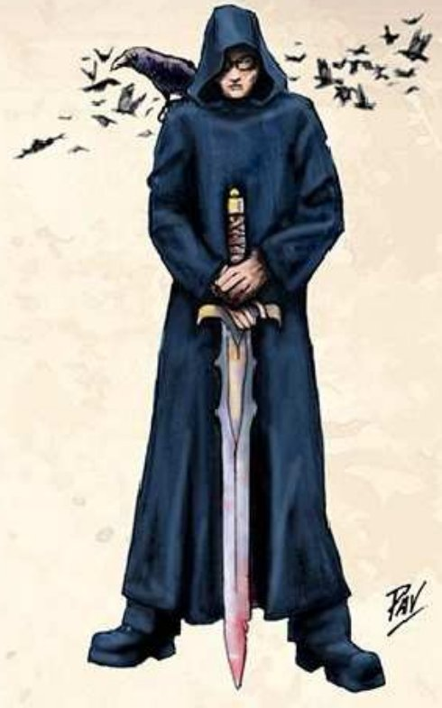

и не давать звёздному отродью устроить кровавую бойню. Но он всё ещё может призывать ворон в округе, чтобы те исполняли его волю (см. заклинание «Власть над птицами» в справочном разделе). Габриэль — искусный фехтовальщик и в бою полагается на своё мастерство мечника. Именно его отец нашёл загадочную статую, которую ищут сыщики, и привёз её в Часовню созерцания в день большой полицейской облавы.

Сейчас у Габриэля роман с Шэдоуз, и если сыщики убьют глубоководных, он поведёт нападение на них. Если ему придётся совсем туго, он сотворит «Власть над птицами» в надежде, что Шэдоуз его спасёт. Если его убьют, звёздное отродье вырвется на свободу, и начнётся финальное событие.

В столе в комнате Габриэля заперт дневник. Если его прочитать, выдайте сыщикам предысторию и карты туннелей (с. 52 и 57). В дневнике три заклинания: «Связь со звёздным отродьем», «Массовое обаяние» и «Призыв духа-зверя». Подробнее — в справочном разделе.

```stat
Габриэль Ран
СИЛ 60  ВЫН 70  ТЕЛ 65  ИНТ 80  МОЩ 90  ЛВК 80
НАР 80  Рассудок 0  ОБР 80  ПЗ 13  Скорость: 8  Комплекция: 1  ПМ 18
БкУ: +1d4        Уклонение 45%
Снаряжение: зачарованный клинок, МБ: +1d6
Бой: Меч 90%, урон 1d8+2 + БкУ + МБ
Навыки: Обаяние 90%; Мифы Ктулху 50%;
Внимание 80%; Слух 60%;
Убеждение 60%; Оккультизм 80%; Психология 80%.
Заклинания: Призыв духа-зверя.
```

*МБ — магический бонус клинка.*

<u>Рэйвен «Шэдоуз» Алексис.</u> Рэйвен вышла замуж за Джека Сардоникуса, потому что считала его силой, стоящей за культом: ведь он был его видимым главой. Вскоре она поняла, что он лишь подставное лицо, а настоящая власть — у Габриэля. Тогда она сама завела роман с Габриэлем, и ей, в общем-то, всё равно, узнает Джек или нет.



Прозвище Шэдоуз («Тени») она получила за сверхъестественную способность управлять тенями вокруг себя. Всякий раз, когда сыщики сталкиваются с Габриэлем, она рядом с ним: держится позади, а если сыщики начнут стрелять — прикрывает обоих заклинанием «Защита тенями», а чтобы скрыться — пользуется заклинанием «Скрывающие тени». Подробнее — в справочном разделе в конце книги.

```stat
Рэйвен «Шэдоуз» Алексис
СИЛ 50  ВЫН 40  ТЕЛ 50  ИНТ 80  МОЩ 85  ЛВК 90
НАР 75  Рассудок 0  ОБР 60  ПЗ 9  Скорость: 8  Комплекция: 0  ПМ 17
БкУ: нет        Уклонение 70%
Бой: Драка 25% (12/5), урон 1d3 + БкУ
Кинжал 30% (15/6), урон 1d4 + БкУ
Навыки: Обаяние 40%; Маскировка 70%;
Мифы Ктулху 40%; Оккультизм 80%.
Заклинания: Защита тенями,
Скрывающие тени.
```
