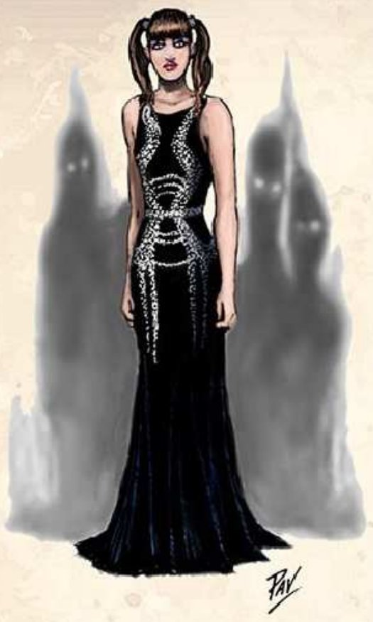

# Место 15

## Инструментальная компания Кейп-Энн

Инструментальная компания Кейп-Энн стоит прямо на берегу Пиджен-Коув. В этом большом здании плавят сталь и штампуют инструменты. Дайте им чертёж и пару дней — и они сделают почти всё, что нужно заказчику. Кроме того, Джеффри заправляет контрабандой оружия и за подходящую цену может достать кому угодно любое оружие на выбор или виски. Здесь работают ещё три-четыре человека, но они всегда отсылают посетителей к Джеффри.

Это здание странной формы, из дерева и металла. Одни его части выглядят новее других. Главная его примета — большая круглая белая труба, торчащая вверх на 13 м. Здание обветшало: краска облезает, металл ржавеет.

<u>Джеффри Грейвз.</u> Джеффри 28 лет, рост 183 см, у него оливковая кожа и голубые глаза, тонкие каштановые волосы и клочковатая бородка. Джеффри капризен, проказлив и транжира. Он не член культа и нарочно старается ничего о нём не знать, хотя знает, что культ существует. Ему принадлежит инструментальный завод, и он заправляет контрабандой оружия и спиртного.

# Место 16

## Дом ведьмы

Этот старый дом построен в 1692 году, когда Мэри Проктор, на сносях, была осуждена в Салеме за колдовство. Её сыновьям было тогда всего 11 и 12 лет. Их отец, тоже осуждённый за колдовство, молил судью о пощаде. Судья пощадил Мэри — лишь изгнал её из Салема, — а мужа её повесил. Мэри с сыновьями, ища лишь уединения, оказалась в Пиджен-Коув — малонаселённой местности к северу от деревушки, которая со временем станет Рокпортом. Сыновья построили дом скорее как крепость, чем как жильё. Там она родила и вырастила третьего ребёнка. Рассказывали, что из дома, который местные стали называть «Домом ведьмы», в любой час ночи доносились крики и виднелись странные огни³.

*³ Сноска оригинала: источник указан в «Справочных заметках» (с. 94).*

Сыновей видели вне дома всё реже, пока они и вовсе не перестали приходить в город за припасами. Огни и шум прекратились, и дом много лет стоял пустой и мёртвый. В конце концов его забрал город. Что стало с младенцем, никто точно не знает. Вокруг дома выращивали необычное растение под названием синий очиток, но теперь он одичал.
