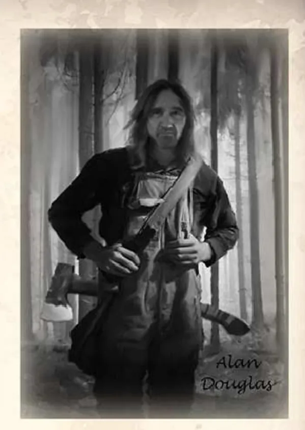

# Место 17
## Дом старика Дугласа

От грунтовой дороги у карьера № 3 отходит узкая тропа: она уводит в глубь леса, к этому деревянному дому чуть севернее карьера № 3. На карте игроков дома нет. Добраться до него трудно, если не знать дороги, и только пешком. Дом стоит на небольшой поляне; рядом — поленница и несколько звериных шкур, растянутых на рамах для выделки. Больше всего в постройке поражают знаки, выжженные на наружных стенах. Успешная проверка Оккультизма покажет, что это охранные и защитные знаки, отгоняющие злых духов. На поляне повсюду стоят резные деревянные фигуры. Одни — на полках, а крупные, высотой от 60 до 90 см, расставлены прямо на земле. Большинство изображает лесных зверей — оленей, медведей, птиц и других, но есть и существа, каких сыщики никогда не видели. Успешная проверка Мифов Ктулху покажет, что это Король в жёлтом, Ньярлатхотеп, Йиг, Атлач-Нача, а также глубоководный, ми-го, Старец и йитианин. На каждую фигуру нужна отдельная проверка.



<u>Алан Дуглас</u>. Алану всего за сорок, но при тех редких встречах с людьми, что у него бывают, он кажется намного старше. Раньше он жил в Рокпорте и кормился охотой, но, повидав слишком много странного, ушёл в лес ждать конца света. Почти всё время он охотится и режет по дереву в лесной тишине. Если сыщики придут к его дому, он будет сидеть в засаде с винтовкой, наведённой на них. Он видел призыв звёздного отродья и видел, как оно упало в океан в начале недели, и считает, что это знамение конца дней.

Хоть Алан и пессимист, его можно уговорить помочь сыщикам в сценарии «Ключ к Бездне». Он может вырезать деревянное ядро и нанести на него символы. Разумеется, на копию он может нанести только видимые символы, но не скрытый. Ещё он знает, что у Дома ведьмы растёт синий очиток. Если спросить его о звёздном отродье и о том, как бы он с ним справился, он посоветует сыщикам заморозить его. Со звёздным отродьем он помогать не станет.

```stat
Алан Дуглас
СИЛ 70  ВЫН 70  ТЕЛ 60  ИНТ 60  МОЩ 60  ЛВК 70
НАР 50  Рассудок 28  ОБР 60  ПЗ 13  Скорость: 9  Комплекция: 1
Бонус к урону: +1d4     Уклонение 65%
Бой: Топор 60% (30/12), урон 1d8+2+БкУ
Навыки: Мифы Ктулху 70%; Искусство/ремесло (резьба по дереву) 80%;
Выживание 80%; Охота 70%; Оккультизм 60%;
Наука (ботаника) 60%; Ориентирование 50%;
Иностранные языки (греческий, арабский, латынь, испанский) 50%
```
